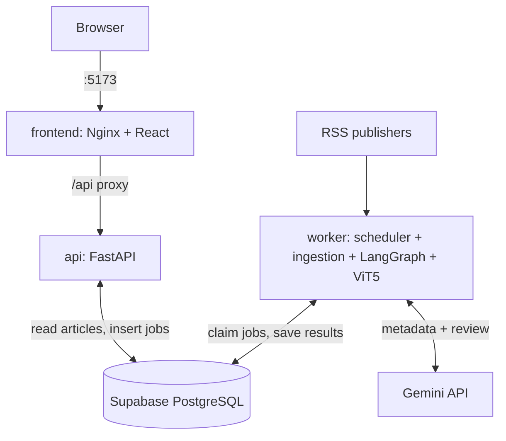

# Architecture — Vietnamese AI News Reader

A local, single-user Vietnamese news reader. It collects articles from a few publisher RSS feeds, summarizes them with a local ViT5 model, uses Gemini for category/keywords and review, stores everything in Supabase PostgreSQL, and shows it in a React UI.

**Status (2026-11-25):** backend complete (ingestion, AI workflow, jobs, worker, scheduler); reader UI and Docker setup implemented; end-to-end checks and some UI features remain. See [todos.md](todos.md).

**Guiding principle:** build a simple working vertical slice first; add complexity only for a demonstrated need.

## Specs

| Spec | Covers |
| --- | --- |
| [Database](specs/database.md) | Tables, enums, constraints, migrations, session rules |
| [Ingestion](specs/ingestion.md) | RSS collection, dedup, text extraction, images, access rules |
| [Summarization](specs/summarization.md) | LangGraph workflow, ViT5, Gemini, persistence |
| [Backend](specs/backend.md) | REST API, jobs, worker, scheduler, configuration |
| [Frontend](specs/frontend.md) | React reader structure and UI rules |
| [Deployment](specs/deployment.md) | Docker Compose, model baking, local run |
| [Testing](specs/testing.md) | Test layers, commands, coverage |
| [Source evidence](specs/source-evidence.md) | Publisher feeds, terms and policy decisions |

## Scope

**In scope:** curated RSS sources (VnExpress, Tuổi Trẻ active; Thanh Niên pending), URL deduplication, permitted full-text extraction with RSS fallback, local ViT5 summaries, Gemini metadata/review via LangGraph, manual and 30-minute scheduled jobs, paginated REST API, Vietnamese reader UI, Docker Compose.

**Out of scope:** authentication, public hosting, user accounts, personalization, vector search, paywall bypass, large-scale crawling, model training, multi-agent systems, LangGraph server/checkpoints, Redis/Kafka/Celery/RabbitMQ, Kubernetes, microservices, Prometheus/Grafana, CI/CD.

All summaries are **AI-generated and may be imperfect**; every item links to its original.

## Tech stack

| Concern | Choice |
| --- | --- |
| Frontend | React 19, Vite 7, TypeScript, Tailwind CSS v4, shadcn/ui; Nginx in Docker |
| API | FastAPI, Pydantic 2, Uvicorn |
| Database | Supabase PostgreSQL, SQLAlchemy 2.1, psycopg 3, Alembic |
| Summarization | `VietAI/vit5-base-vietnews-summarization` (Transformers 4.x, CPU PyTorch) |
| AI review | Gemini Developer API via `google-genai` (Interactions API) |
| Orchestration | LangGraph `StateGraph` |
| Collection | httpx, feedparser, BeautifulSoup |
| Scheduling | APScheduler 3.x inside the worker; jobs table in PostgreSQL |
| Tooling | Python 3.12, uv, pytest, Ruff, npm, ESLint, Docker Compose |

## System overview



Three processes, one Python codebase (modular monolith):

- **frontend** — serves the SPA, proxies `/api` to the API. No credentials.
- **api** — read endpoints, job submission (`202 Accepted`), `/health`. Never runs RSS collection, models or the scheduler.
- **worker** — loads ViT5 once, runs the scheduler, claims jobs, collects feeds, runs the graph, saves results. Exactly one replica; no HTTP port.

API and worker communicate **only through PostgreSQL** (jobs and article rows), never HTTP.

## Data flow

1. A job is created — by `POST /api/v1/ingestion-jobs` or the 30-minute scheduler.
2. The worker atomically claims it (`FOR UPDATE SKIP LOCKED`) and commits the claim.
3. Pending backlog is processed first, then each source's RSS feed is fetched; new articles are inserted with a unique `canonical_url`.
4. Text is prepared: permitted HTML extraction, else RSS excerpt. Under 200 characters → `needs_review`.
5. Each usable article goes through LangGraph: ViT5 draft → Gemini metadata → Gemini review, at most two drafts.
6. Summary + article status (`ready`) + job counters are saved in one transaction.
7. The API returns only `ready` articles with approved summaries; the UI displays them.

## Key design rules

- **Deterministic orchestration.** Collection, dedup and persistence are plain Python; the LLM never chooses tools or writes to the DB.
- **Short transactions.** Never hold a DB transaction during HTTP, model or Gemini calls.
- **Idempotent writes.** Unique constraints and conditional updates make replays safe; no exactly-once assumptions.
- **Bounded everything.** ≤ 3 HTTP requests per fetch, ≤ 2 drafts per article, ≤ 20 inserts and 20 results per job, backlog ≤ 5 jobs.
- **Offline model.** ViT5 loads from local files only; no runtime downloads.
- **Respect publishers.** Attribution, original links, robots.txt, no paywall bypass. See [source evidence](specs/source-evidence.md).
- **Local only.** Ports bind to `127.0.0.1`; no auth because there is no shared access.
- **Secrets stay in `.env`.** Never in code, logs or the browser.

## Repository layout

```text
backend/app/      FastAPI app, worker, services, agents, models, CLI
backend/alembic/  Migrations
config/sources.json  Reviewed source and access policy
frontend/         React reader
tests/            unit, integration/, model/, live/
docs/             this file, specs/, logs/, archived/, todos.md
compose.yaml      frontend + api + worker
```

## Risks and trade-offs

| Risk | Mitigation |
| --- | --- |
| Publisher feed changes / reuse terms | Reviewed config, fixtures in tests, attribution, keep Thanh Niên off |
| LLM hallucination | Source-only prompts, review step, bounded drafts, "AI-generated" label |
| Short RSS excerpts | Store `content_origin`; skip text under 200 chars |
| Duplicates / crashes | Unique constraints, atomic claims, startup recovery, one worker |
| Gemini cost / rate limits | Per-job caps, bounded retries, input truncation |
| CPU latency / RAM (~1.3 GiB) | One preloaded model, bounded tokens, small batches |

Using PostgreSQL as a job queue is a deliberate trade-off for a low-volume single-worker app. Gemini review is a quality heuristic, not journalistic fact-checking.

## History

Key decisions and their reasons are in [decisions.md](decisions.md). Implementation logs are in [logs/](logs/). The original 14-day plan and the long-form architecture are preserved in [archived/](archived/) and git history.
