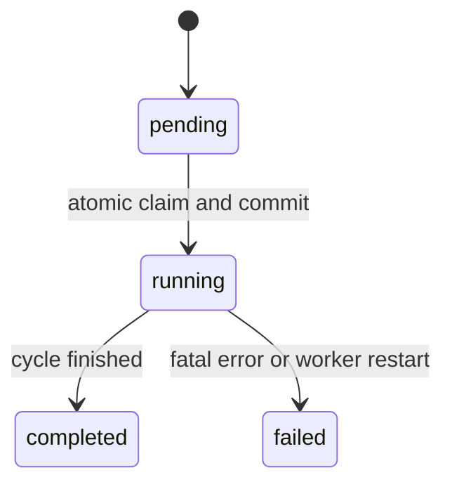

# Backend spec (API, worker, jobs)

← Back to [architecture](../architecture.md)

One Python package (`backend/app`, Python 3.12, uv) runs as two processes: the FastAPI **api** and the standalone **worker**. They never call each other; they share PostgreSQL.

## Code layout

| Path (`backend/app/`) | Responsibility |
| --- | --- |
| `main.py`, `api/`, `schemas.py` | FastAPI app, thin route handlers, Pydantic response schemas |
| `core/config.py` | Settings from env/`.env`, validated limits |
| `db/` | Lazy engine/session (`session.py`), connection probe (`probe.py`) |
| `models/` | SQLAlchemy models and enums — see [database spec](database.md) |
| `services/` | Ingestion, extraction, ViT5, Gemini, persistence, jobs |
| `agents/` | LangGraph workflow — see [summarization spec](summarization.md) |
| `cli/ingest.py` | Manual collection/processing command |
| `worker.py` | Scheduler, job loop, startup recovery, shutdown |
| `seed_sources.py`, `backfill_article_images.py` | One-off maintenance commands |

## REST API

No auth; local loopback only. Timestamps are ISO 8601 UTC.

| Method | Route | Result |
| --- | --- | --- |
| `GET` | `/health` | `200 {"status":"ok"}`, no DB/provider call |
| `GET` | `/api/v1/articles` | `ArticlePage`; params `page≥1`, `page_size` (default 20, max 100), `q` (≤200 chars), `category`, `source_id` |
| `GET` | `/api/v1/articles/{id}` | `ArticleDetail`; 404 if absent |
| `GET` | `/api/v1/sources` | Active `SourceRead[]`, sorted by name/id |
| `POST` | `/api/v1/ingestion-jobs` | Body `{"source_id": null}` → `202 {"job_id", "status":"pending"}` + `Location` |
| `GET` | `/api/v1/ingestion-jobs/{id}` | `IngestionJobRead`; 404 if absent |

**Schemas** (`schemas.py`):

| Schema | Fields |
| --- | --- |
| `SourceRead` | id, name, rss_url, last_fetched_at? |
| `ArticleCard` | id, title, original_url, image_url?, source, published_at?, created_at, content_origin?, processing_status, category?, summary_preview?, input_truncated? |
| `ArticleDetail` | `ArticleCard` + summary? (`SummaryRead`) + `ai_generated` |
| `SummaryRead` | summary_text, keywords, summarize_model_name, agent_model_name, created_at, input_truncated |
| `ArticlePage` | items, total, page, page_size |
| `IngestionJobRead` | job_id, source_id?, trigger, status, attempts, five counters, timestamps, error_message? |

**Behavior:**

- Filters combine with AND. `q` searches titles with parameterized `ILIKE` (wildcards escaped). The count uses the same filters. Out-of-range pages return empty items with the true total.
- Articles with a persisted rejected draft in `needs_review` are omitted from list results and totals, and return 404 on detail reads.
- Summary, category, keywords and preview (≤ 240 chars) appear **only** for `ready` articles with an approved summary (`_is_visible` in `api/articles.py`). Raw content, RSS HTML and prompts are never returned. `ai_generated` is true only when a summary is shown.
- Errors: unknown source on POST → 404; inactive/no active sources → 422; backlog full (`MAX_JOB_BACKLOG`, default 5) → 429; DB unavailable → redacted 503. App errors use `detail: {code, message}`.

## Jobs

- **Submit** (API or scheduler): a short transaction with a shared PostgreSQL advisory lock rechecks scope, backlog cap and scheduled duplicates before insert (`services/job_service.py`).
- **Claim:** oldest pending job via `SELECT ... FOR UPDATE SKIP LOCKED`, set `running`/`attempts`/`started_at`, **commit before** any publisher/model/provider work.
- **Cycle order** (`Worker._run_job`): for every eligible source, first process the backlog (`process_pending`: recover excerpt-only rows → prepare text → summarize). Then, per source, collect the feed, insert new entries, and run `process_pending` again.
- **Budgets per job:** 20 new insertions and 20 terminal results (independent). Leftover rows stay pending for the next job.
- **Counters** commit together with the matching insert or status change. Replays skip existing URLs and terminal articles without counting again.
- **Outcome:** at least one successful feed (an empty feed counts) → `completed`, with partial-failure detail if needed. All feeds failed or a fatal DB error → `failed`. A single article's AI failure only fails that article.

## Worker

Run: `HF_HUB_OFFLINE=1 TRANSFORMERS_OFFLINE=1 uv run --locked --env-file .env python -m app.worker` (optional `--config path/to/sources.json`).

- Loads ViT5 once, builds one graph/provider, runs startup recovery, then polls every `WORKER_POLL_INTERVAL_SECONDS` (default 10).
- **Startup recovery:** marks abandoned `running` jobs `failed` and resets `processing` articles to `pending`. Committed results and counters are kept. Failed jobs are not retried automatically.
- **Scheduler:** one in-memory APScheduler 3.x `BackgroundScheduler`, UTC interval of `COLLECTION_INTERVAL_MINUTES` (default 30), `coalesce=True`, `max_instances=1`. The callback only enqueues a job (own session). A pending/running scheduled job suppresses new ticks. Restart starts a fresh interval; missed ticks are not replayed.
- **Shutdown:** SIGTERM/SIGINT stops new claims/ticks between operations; an interrupted job stays `running` until the next startup recovery.
- **Exactly one worker replica.** Recovery assumes the previous worker has stopped; there is no timeout-based reclaim.

## Configuration

`.env.example` is the reference (never commit `.env`):

| Variable | Default / meaning |
| --- | --- |
| `DATABASE_URL` | `postgresql+psycopg://...?sslmode=require` |
| `GEMINI_API_KEY`, `GEMINI_MODEL` | Gemini credentials and model ID |
| `SUMMARIZATION_MODEL_ID`, `SUMMARIZATION_MODEL_PATH` | ViT5 ID and local artifact path |
| `SUMMARIZATION_CPU_THREADS` | 4 |
| `COLLECTION_INTERVAL_MINUTES` | 30 |
| `WORKER_POLL_INTERVAL_SECONDS` | 10 |
| `JOB_MAX_ARTICLE_INSERTIONS`, `JOB_MAX_ARTICLE_RESULTS` | 20, 20 |
| `MAX_JOB_BACKLOG` | 5 |
| `MAX_GRAPH_DRAFT_ATTEMPTS` | 2 (max 2) |
| `HF_HUB_OFFLINE`, `TRANSFORMERS_OFFLINE` | 1 at runtime |
| `LOG_LEVEL` | Declared, not yet wired into logging |

The API validates only what it needs, so `/health` works without DB, key or model. Logs must not contain secrets, article bodies or raw provider payloads.

## Related

- [Database spec](database.md), [ingestion spec](ingestion.md), [summarization spec](summarization.md), [deployment spec](deployment.md)
- [Day 7 log](../logs/2026-10-15-day-7-worker-jobs.md)
