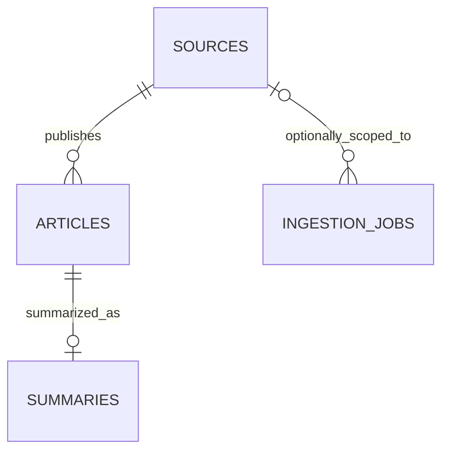

# Database spec

← Back to [architecture](../architecture.md)

Supabase-hosted PostgreSQL is the single source of truth. API and worker both use SQLAlchemy 2.x (`postgresql+psycopg://`, TLS required). Schema changes go through Alembic only.

## Tables



All IDs are `BigInteger Identity()` primary keys. All timestamps are `TIMESTAMPTZ` (UTC).

| Table | Fields (nullable marked `?`) |
| --- | --- |
| `sources` | `name` varchar(120); `rss_url` text **unique**; `is_active` bool (default true); `last_fetched_at?` |
| `articles` | `source_id` FK; `original_url`, `canonical_url` **unique**, `title` text; `image_url?`, `rss_description?`, `content?` text; `content_origin?`; `publisher_meta?` JSONB; `processing_status` (default `pending`); `processing_error?`; `published_at?`; `created_at`; `updated_at` |
| `summaries` | `article_id` FK **unique** (one summary per article); `summary_text`; `category`; `keywords` JSONB array; `summarize_model_name`, `agent_model_name` varchar(160); `approved` bool; `review_feedback?`; `draft_attempts` (1–2); `input_truncated` bool; `human_review_decision?`, `human_review_note?`, `human_reviewed_at?`; `created_at`; `updated_at` |
| `ingestion_jobs` | `source_id?` FK (NULL = all active sources); `status` (default `pending`); `trigger`; `attempts`; counters `articles_created/summarized/processed/failed/needs_review`; `error_message?`; `created_at`; `started_at?`; `finished_at?` |

Models live in `backend/app/models/` with a single `Base`.

## Enums

Defined in `backend/app/models/enums.py` and stored as VARCHAR with named check constraints via the `string_enum()` helper (`native_enum=False`, `create_constraint=True`, `validate_strings=True`, lowercase values). Changing allowed values needs a migration.

| Enum | Values |
| --- | --- |
| `ProcessingStatus` (article) | `pending`, `processing`, `ready`, `needs_review`, `failed` |
| `ContentOrigin` | `extracted`, `rss_excerpt` (NULL when no text) |
| `Category` | `politics`, `economy`, `technology`, `society`, `sports`, `other` |
| `JobStatus` | `pending`, `running`, `completed`, `failed` |
| `JobTrigger` | `manual`, `scheduled` |

## Rules and constraints

- **Deduplication:** `articles.canonical_url` is unique; inserts use `ON CONFLICT DO NOTHING RETURNING id`. Never rely on in-memory sets.
- **Publisher metadata:** `articles.publisher_meta` is NULL when missing. Otherwise it maps `article:section`, `its_subsection`, `news_keywords`, `article:tag`, `its_tag`, `its_type` and `its_wordcount` to arrays of raw values. Repeated tags retain their page order.
- **Counters:** nonnegative, and `articles_processed = summarized + failed + needs_review`.
- **Visibility:** a summary is shown only when the article is `ready` **and** the summary is `approved`. Graph approval writes both fields in one transaction. Rejection writes an unapproved draft, `needs_review` status and the job counter together. The API excludes these rejected articles.
- **Human review columns** (revision `0004`): a check requires `accept` ⇒ approved and `decline` ⇒ not approved with a note. The manual-review UI/API was removed on 2026-11-07; the unused columns are scheduled for removal in P2.2.
- **Ordering:** newest first by `COALESCE(published_at, created_at) DESC, id DESC`.
- **Deletion:** sources are deactivated, not deleted (FK restricted). Deleting an article cascades to its summary. No delete endpoints exist.
- **Defaults** are database-side (applied on INSERT). `updated_at` uses `onupdate=func.now()`; raw SQL updates must set it explicitly.
- **Indexes:** article `published_at` and `source_id`, summary `category`, jobs `(status, created_at, id)` and `source_id`.

## Migrations

| Revision | Change |
| --- | --- |
| `0001` | Initial schema: four tables, enum checks, constraints, indexes |
| `0002` | Rename summary `model_name` → `summarize_model_name` |
| `0003` | Add nullable `articles.image_url` |
| `0004` | Add `human_review_*` audit columns and check |
| `0005` | Add nullable `articles.publisher_meta` |

```sh
uv run --locked alembic upgrade head
uv run --locked alembic current
```

Run migrations explicitly before starting services, never at app startup. Never use `Base.metadata.create_all()`. Add a new revision for every schema change.

## Connection and session rules

- Take the real URL from Supabase's **Connect** dialog: direct connection where IPv6 works, otherwise the **session pooler** on port 5432. Add `sslmode=require`.
- Pool: `pool_size=2`, `max_overflow=1`, `pool_pre_ping=True`.
- `db/session.py` lazily creates and caches the engine/session factory (`expire_on_commit=False`); `get_db()` yields one session per request.
- One short session per unit of work. **Never hold a transaction open during HTTP, model or Gemini calls.**
- No database credentials or Supabase keys in browser code.

Verify connectivity with `uv run --locked --env-file .env python -m app.db.probe`.

## Related

- [Backend spec](backend.md) — job claiming and the REST contract
- [Testing spec](testing.md) — integration tests in disposable schemas
- [Day 2 log](../logs/2026-10-14-day-2-database-to-rest.md) — original setup walkthrough
