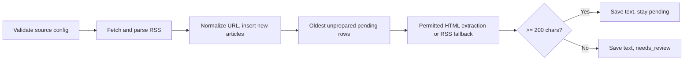

# Ingestion spec

← Back to [architecture](../architecture.md)

Ingestion is ordinary deterministic Python, **outside LangGraph**: read reviewed sources, fetch RSS, deduplicate, prepare text. No LLM decides what to fetch or save.



## Pipeline stages

| Stage | Code | Behavior |
| --- | --- | --- |
| Source config | `core/source_config.py`: `SourceConfig`, `load_source_config()`. `cli/seed_sources.py`: `seed_sources()` | Pydantic validates `config/sources.json` before DB access. Seeds only `name`, `rss_url`, `is_active` (upsert by RSS URL). Policy fields stay in JSON. `SourceConfig.is_usable` is the single eligibility check. |
| Fetch and parse | `services/rss_collector.py`: `RSSCollector.collect()` | Returns `FeedEntry` items. Cleans title/description HTML, skips entries without title or with invalid links, converts dates to UTC (else NULL). Malformed feed = error; empty feed = success. |
| URL identity | `services/url_normalization.py`: `normalize_url()` | Lowercase scheme/host, drop default ports, fragments and tracking params; keep identifying path/query. Stores original and canonical URL. |
| Insert | `services/feed_ingestion.py`: `ingest_entries()` → `insert_article()` | Conflict-safe insert. Duplicates never consume capacity or overwrite rows. |
| Prepare text | `services/text_preparation.py`: `prepare_pending_articles()`, `recover_review_articles()` | Picks oldest `pending` rows with no content. Tries permitted HTML extraction (`services/article_extractor.py`), falls back to the RSS description. Max 20,000 chars. |
| Source guard | `services/source_guard.py`: `require_active_source()` | Rechecks source activation before each write. |
| Images | `services/article_images.py` | Captures optional image URLs (see below). |

## Text quality contract

`ArticleExtractor.extract()` returns an `ExtractionResult`:

| Field | Meaning |
| --- | --- |
| `text` | Cleaned plain text, ≤ 20,000 characters, or `None` |
| `content_origin` | `extracted`, `rss_excerpt`, or `None` |
| `usable` | At least 200 cleaned characters |
| `failure_reason` | Fixed redacted codes, e.g. `extraction_disabled; insufficient_text` |

- Usable text stays `pending` for AI processing; short/missing text becomes `needs_review`.
- HTML extraction uses only the configured CSS content selector; it never falls back to the whole page. Scripts, nav, forms, ads and related content are removed.
- `recover_review_articles()` retries older excerpt-only `needs_review` rows (reason `extraction_disabled; ...`) once extraction is enabled, returning them to `pending`.

## HTTP and access rules

- Identifying user agent, 15 s timeout, 1 s delay between requests.
- At most **3 requests per fetch**, shared between redirects and retries, with bounded backoff.
- HTTPS only, exact host allowlist, every redirect revalidated.
- Body caps: 2 MiB for feeds/HTML, 256 KiB for robots.txt.
- Article extraction also requires a reviewed public path prefix and current robots.txt permission. Access-denied responses are not retried. No paywall or login bypass.
- Robots rules describe crawler access only; reuse and AI processing need separate review (see [source evidence](source-evidence.md)).

## Sources (current configuration)

| Source | Active | Extraction | AI processing | Selector |
| --- | --- | --- | --- | --- |
| VnExpress (`/rss/tin-moi-nhat.rss`) | yes | yes | yes | `article.fck_detail` |
| Tuổi Trẻ (`/home.rss`) | yes | yes | yes | `div.detail-content` |
| Thanh Niên (`/rss/home.rss`) | no | no | no | — |

Enabling extraction requires `article_extraction_allowed: true` plus an `article_extraction` object (`public_path_prefixes`, `content_selector`, `review_note`). Enabling AI requires `ai_processing_allowed: true` plus `ai_processing_review_note`. Thanh Niên stays inactive until its reuse terms are resolved.

## Transactions and recovery

- Feed fetching finishes **before** the insert transaction opens.
- Text preparation reads a snapshot, closes the transaction, does publisher IO, then commits each result separately with a conditional update (still pending, unprepared, same URL/description). Concurrently changed rows are skipped.
- Committed work survives interruption; later runs resume old unprepared rows even if they have left the feed.
- Insertion and preparation have separate caps (`JOB_MAX_ARTICLE_INSERTIONS`, `JOB_MAX_ARTICLE_RESULTS`, default 20 each). Older backlog goes first.

## Article images

Optional publisher metadata, independent of AI approval:

- RSS: Media RSS thumbnails/content, image enclosures, `` in the description (read before stripping HTML).
- HTML (only when extraction is permitted): `og:image`, Twitter image, or an image in the content container. RSS images take precedence.
- Only public HTTPS URLs without credentials or unusual ports. The backend never downloads image files; the browser loads them with `referrerPolicy="no-referrer"`.
- Backfill existing rows (fills only NULL `image_url`):

```sh
uv run --locked python -m app.cli.backfill_article_images                      # dry run
uv run --locked python -m app.cli.backfill_article_images --from-pages --apply # save
```

## Manual commands

```sh
uv run --locked --env-file .env python -m app.cli.seed_sources
uv run --locked --env-file .env python -m app.cli.ingest --source-id 1 --verify-repeat
uv run --locked --env-file .env python -m app.cli.ingest --source-id 1 --prepare-only
```

`--verify-repeat` replays the attempted slice and expects zero new inserts. `--prepare-only` skips collection and resumes text preparation. Logs carry fixed event names and numeric source, article and job IDs. Publisher URLs, credentials and article text are excluded.

## Related

- [Source evidence](source-evidence.md) — feed URLs, terms and policy gates
- [Summarization spec](summarization.md) — what happens to `pending` text next
- [Day 4 log](../logs/2026-10-15-day-4-text-extraction.md), [article images log](../logs/2026-11-08-article-images.md), [ingestion refactor log](../logs/2026-11-25-refactor-ingestion.md)
