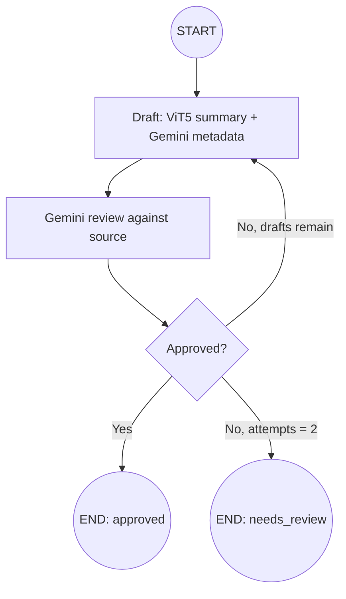

# Summarization workflow spec

← Back to [architecture](../architecture.md)

Each eligible `pending` article runs through **one LangGraph invocation**. Local ViT5 writes the summary; Gemini supplies category/keywords and reviews the summary against the source. Gemini never replaces ViT5 as the summarizer.

## Graph



- Built by `agents/graph.py` (`build_news_graph`) with `StateGraph`, explicit conditional mapping, and `recursion_limit=8` as a safety stop.
- **At most two drafts** (`MAX_GRAPH_DRAFT_ATTEMPTS`, can be lowered to 1).
- Each invocation starts from article inputs only; no stale approval/attempt state.
- Draft resets approval/feedback and recomputes metadata. Review feedback **never** goes into ViT5 input (ViT5 is not a chat model).

## State

`agents/state.py` — `NewsState(TypedDict, total=False)`:

| Field | Meaning |
| --- | --- |
| `article_id`, `title`, `source_text`, `content_origin` | Inputs |
| `inference_text`, `input_truncated` | Exact text kept after tokenizer truncation |
| `summary`, `category`, `keywords` | Draft outputs |
| `approved`, `feedback` | Review result |
| `attempts` | Drafts so far (starts at 0, max 2) |
| `outcome` | `approved` or `needs_review` |

## Output schemas

`agents/schemas.py`:

| Schema | Content |
| --- | --- |
| `ArticleMetadata` (Gemini) | `category: Category`; 3–5 distinct non-empty Vietnamese keywords, ≤ 80 chars each |
| `NewsDraft` (assembled in Python) | metadata + ViT5 `summary` |
| `ReviewResult` (Gemini) | `approved: StrictBool`; `feedback` ≤ 1,000 chars, reason required on rejection |

Unknown fields are rejected.

## ViT5 (`services/summary_service.py`)

- Model `VietAI/vit5-base-vietnews-summarization`, loaded **once** from `SUMMARIZATION_MODEL_PATH` with `local_files_only=True`, CPU, `eval()`, `torch.inference_mode()`. Missing/corrupt files fail at startup; never download at runtime.
- `model_manifest.json` (written by `download_summarization_model.py`) records model ID, revision, sizes and SHA-256; it is validated before loading.
- Input ≤ 1,023 content tokens + EOS (1,024 total). No instruction prefix.
- Deterministic decoding, ≤ 256 new tokens, no repeated trigrams. Attempt 1: 4 beams, length penalty 1.0. Attempt 2: 2 beams, length penalty 0.8.
- `SUMMARIZATION_CPU_THREADS` (default 4).
- Only the worker (and explicit CLI processing) loads the model; the API never does.

Smoke test: `HF_HUB_OFFLINE=1 TRANSFORMERS_OFFLINE=1 uv run --locked --env-file .env python -m app.services.summary_service --smoke-test`

## Gemini (`services/gemini_service.py`)

- Official `google-genai` SDK, Developer API (`vertexai=False`), `client.interactions.create(..., store=False, response_format={type: "text", mime_type: "application/json", schema: <Pydantic JSON schema>})`.
- Parse `interaction.output_text` with `model_validate_json`; require completed, non-empty output.
- 30 s timeout per HTTP attempt. `HttpRetryOptions.attempts=2` means **2 retries = 3 wire requests** in google-genai 2.29. Retries on 429/500/502/503/504 only. No extra app retry loop.
- Worst case: 2 operations × 2 drafts × 3 requests = **12 requests per article**.
- Prompts (`agents/prompts.py`) keep instructions separate from article JSON. Article and summary text are untrusted data, not instructions.
- `GEMINI_MODEL` is configurable (verified: `gemini-3.8-flash`).

Review checks names, dates, numbers, quotes and critical claims against the supplied source. It is a quality heuristic, **not fact-checking**.

## Processing and persistence

- `services/article_processing.py` (`process_article`, `NewsProcessor`) checks source AI permission, claims one pending article in a short committed transaction, then runs the graph outside any transaction. The deterministic [extraction gate](ingestion.md#text-quality-contract) moves rejected text and RSS-only rows to `needs_review` without inference.
- `services/summary_persistence.py` (`persist_summary`) locks the article, checks the source text is unchanged, and writes summary + article status + job counter in **one transaction**.
- The validated graph outcome determines publication. Approved drafts are saved as `approved=True` with article status `ready`. Exhausted reviews persist the final draft and review feedback with `approved=False`, set the article to `needs_review`, and increment the job’s needs-review counter. Rejected articles are excluded from the list and return 404 on detail reads.
- Previously auto-approved rows retain their stored state because the previous persistence code discarded the review outcome and free-form feedback cannot reliably reconstruct it.
- Model/provider/schema failures save `failed` with a fixed `AI processing failed` message and no partial summary. Ready/failed articles are never reprocessed automatically.
- `services/pipeline.py` (`open_pipeline`) builds the graph and providers once for the worker and CLI.

Process one article manually:

```sh
HF_HUB_OFFLINE=1 TRANSFORMERS_OFFLINE=1 uv run --locked --env-file .env \
  python -m app.cli.ingest --source-id SOURCE_ID --process-article-id ARTICLE_ID
```

## Optional later: read-only tools

Not implemented. If added: only bounded read-only tools (`get_source_article`, `search_related_articles` with `LIMIT 5`), max 3 tool calls, no DB writes or arbitrary network. Collection, extraction, dedup and persistence stay ordinary services, never LLM tools.

## Related

- [Ingestion spec](ingestion.md) — how `pending` text is prepared
- [Backend spec](backend.md) — worker loop and job counters
- [Day 5 log](../logs/2026-10-15-day-5-vit5-gemini.md), [Day 6 log](../logs/2026-10-15-day-6-review-persistence.md)
