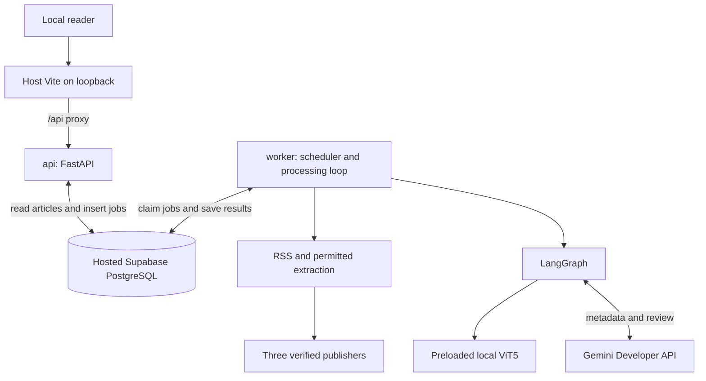
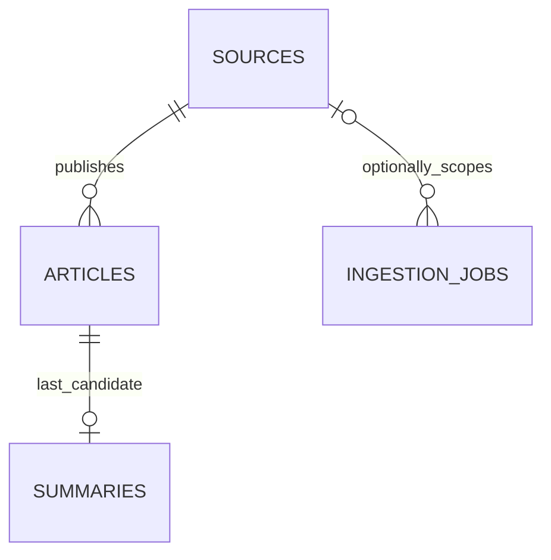
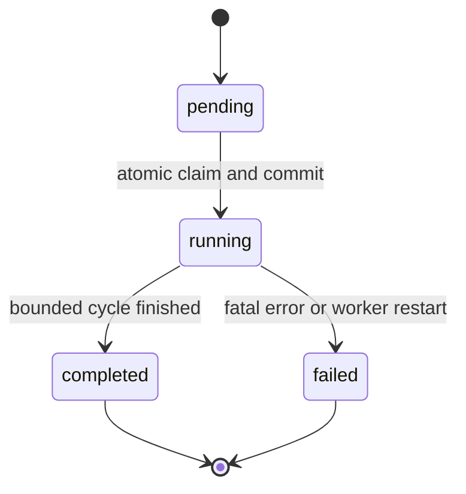
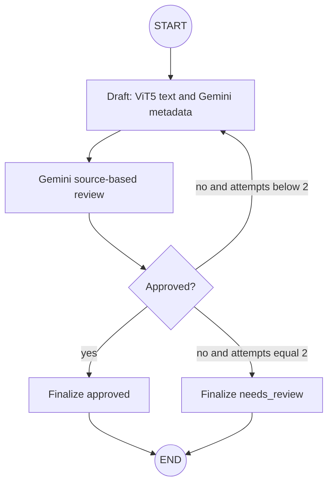

# Implementation plan and 14-day checklist

Follow [architecture.md](architecture.md) for product scope. Work through each day's tasks in order; check a box only after its verification succeeds. Commands for missing modules/tests are planned acceptance checks, not features verified today.

**Time budget:** 5–6 focused hours per day. Days 13–14 provide debugging and setup buffer. When asking for implementation, name the phase or day; implement only that scope, explain the decisions, and run its checks.

## Repository progress — 2026-10-15 (initial audit: 2026-10-12)

Preserve the root uv project and `backend/app` package (`module-name="app"`, `module-root="backend"`), root tests, Python 3.12 selection and existing ORM models. Days 2, 4, 5, 6 and 7 are complete. Day 6 includes real local ViT5/Gemini approval, atomic persistence and HTTP visibility for article 41, alongside hidden rejection for article 5. Day 3 implementation is complete through D3.9: reviewed source configuration, bounded RSS collection, parsing, conservative URL normalization, conflict-safe persistence, live VnExpress collection and REST verification are implemented. The three-source D3.1 policy gate remains open because Thanh Niên reuse is unresolved.

| Area | Current evidence | Remaining work |
| --- | --- | --- |
| API foundation | `/health`, the three D2 read endpoints and POST/GET ingestion-job routes are registered; scope, backlog, visibility and redacted outage behavior are covered | Frontend integration |
| Database declarations | Four models, relationships, enum checks, identities/defaults/indexes exist; mapper configuration and PostgreSQL DDL compile | Retain constraints as later write paths are added |
| Database sessions | Lazy cached engine/session factory and per-request dependency implemented and used by read routes; URL/driver/TLS validation, cache reuse and cleanup tested | Retain regression coverage |
| Migrations | Revisions `0001` and `0002` exist; `0002` renames the summary model column with data-preservation coverage | Apply/verify head on each setup; retain lifecycle tests |
| PostgreSQL integration | **105 distinct PostgreSQL cases** verified across the full regression and final Day 7 job run on 2026-10-15, including migration lifecycle, concurrent jobs, atomic counters, recovery, replay and REST visibility | Retain as regression coverage |
| RSS collection/text preparation | Committed configuration has two reviewed active feeds and one inactive candidate; bounded collection/preparation implemented; a separate user-authorized World-feed source (DB ID 4) supplied the Day 6 live article | Resolve Thanh Niên reuse and live extraction/AI permissions before activation |
| Dependencies | Day 5 locks CPU Torch 2.14.1+cpu; `torch.version.cuda is None`; `uv pip check` reports 90 compatible packages | Retain tested CPU resolution |
| AI/model | Local CPU ViT5, structured metadata/review, bounded StateGraph and atomic summary persistence verified; genuine approved article 41 returned through HTTP; rejected article 5 stays hidden | Retain graph/persistence regression coverage |
| Tooling | uv 0.12.15; Docker Compose 5.6.0 | Node/npm unavailable in this session's PATH; install before frontend work |
| Jobs/worker | Durable POST/GET, atomic claim/counters, single-worker recovery and UTC interval scheduler implemented; live job 1 completed while API was stopped | Retain single-worker deployment and source permission gates |
| Remaining product | Source seeding, read API, ingestion, AI graph/persistence and jobs/worker/scheduler exist | Frontend and containers |

Day 3 evidence: the complete suite passed **127 tests** on 2026-10-14, including **50 integration cases**. The live VnExpress run parsed 51 usable entries, inserted 20 within the cap, replayed the attempted slice with zero new rows and returned the stored article through REST. Day 4 adds guarded text preparation and fictional public-HTML fixtures; live article extraction and publisher AI remain disabled. See [Day 4 verification](day-4-extraction.md). Day 5 verification: **187 unit tests passed**, **2 actual model tests passed**, **1 actual Gemini test passed**; the 60 PostgreSQL cases were not rerun because database behavior did not change. See [Day 5 verification](day-5-model.md). `/health` remains liveness only. Day 6 review and persistence are implemented; see [Day 6 verification](day-6-review.md). Day 7 jobs/worker/scheduler are implemented; see [Day 7 verification](day-7-worker.md). Frontend remains planned.

## Planning deliverables

| Requested deliverable | Location |
| --- | --- |
| (a) Prioritized tasks and dependencies | [Priorities](#priorities-and-dependencies) and phase checklists |
| (b) Models and migrations | [Database contract](#database-contract), Phase 2 and [Day 2 guide](day-2-setup.md) |
| (c) API contracts | [REST contract](#rest-contract) |
| (d) Graph, state and tools | [LangGraph contract](#langgraph-contract), Phase 4 and optional work |
| (e) Containers/local deployment | Phase 7 and architecture sections 4/10/11/12 |
| (f) Testing | [Testing matrix](#testing-matrix) |
| (g) 14-day schedule | Phases 1–8 below; 5–6 hours/day assumed |
| (h) Risks | [Risk register](architecture.md#15-risks-mitigations-and-conscious-trade-offs) and decisions below |
| (i) Exact acceptance | [Acceptance checks](#exact-acceptance-checks) plus per-day checks |

## Priorities and dependencies

| Order | Milestone | Depends on | Exit gate |
| --- | --- | --- | --- |
| P0 / M1 | Migrated DB → fixture article → read REST | Existing health/settings/models; real DB connection | D2.3–D2.11 pass; source/list/detail return fixture |
| P0 / M2 | Permitted RSS → usable persisted text | M1; reviewed source evidence | D3–D4; rerun inserts zero duplicates |
| P0 / M3 | ViT5 → Gemini → approved saved summary | M1; eligible fixture; model artifacts/key/model access | D5–D6; real generation and bounded routing |
| P0 / M4 | Manual/scheduled worker cycle | M2 + M3 | D7; durable claim, counters and recovery |
| P1 / M5 | Vietnamese reader UI | M1 REST contract; M3 saved output; Node/npm | D8–D10; complete reader journey |
| P1 / M6 | Shared image + local reproduction | M4 + M5; Docker | D11–D14; offline model and final acceptance |
| P2 | Ingestion UI, tools, GPU, chunking | All required gates | Optional; remove from the 14-day critical path |

M2 and M3 can be developed independently after M1 using labeled fixtures. Read contracts permit frontend work before live ingestion is available. Keep fixture and live milestones distinct. Model import/CPU/provider feasibility should be resolved by Day 5; do not delay those checks until packaging.

**First smallest end-to-end slice:** one fixture source/article in migrated PostgreSQL → `GET /api/v1/sources`, article list/detail → validated JSON. This exercises persistence, sessions and HTTP without waiting for RSS or AI.

**Next task:** begin Day 8 frontend setup and reader UI. Day 7 durable jobs, recovery and scheduling are verified; live job 1 completed with the API stopped. Day 6 approved-live-result acceptance is verified with article 41. D3.1 and ongoing publisher extraction/AI permissions remain separate policy gates.

## Scope and boundaries

**MVP required:** three verified feeds; deduplicated ingestion; permitted extraction/RSS fallback; local ViT5 summaries; Gemini metadata/review through LangGraph; Supabase PostgreSQL; manual/scheduled jobs; paginated REST API; Vietnamese React list/detail/search/filter UI; tests; local setup.

**Optional later:** ingestion UI, read-only review-agent tools, GPU inference, chunked summaries, full-text search, feed images and extra UI polish.

**Excluded:** auth/roles/accounts, public hosting/Nginx/TLS, personalization, chat/vector search/pgvector, paywall bypass, large-scale crawling, training, multi-agent debate, LangGraph server/checkpoints, another database, microservices, Redis, RabbitMQ, Kafka, Celery, Kubernetes, Elasticsearch, Jenkins, Prometheus, Grafana and CI/CD.



Rules: API and Vite bind to loopback; no authentication. Compose has exactly `api` and `worker`, sharing one image. Worker owns inference and scheduling; API only reads results/enqueues jobs. Vite runs on the host. Supabase, Gemini and publishers require network access.

## Phase 1 — Day 1: API foundation

**Goal:** start a small API and understand packaging, configuration and HTTP responses.

**Files:** `backend/app/main.py`, `backend/app/core/config.py`, `backend/app/db/probe.py`, `tests/test_health.py`, `tests/test_config.py`; update root dependency/ignore files.

### Build in this order

- [x] **D1.1** Add FastAPI/Uvicorn and pytest/httpx/Ruff dependencies using the commands below.
- [x] **D1.2** Create `main.py` with a FastAPI app and only `GET /health` returning `{"status":"ok"}`.
- [x] **D1.3** Write `test_health_returns_ok_without_external_services`: assert HTTP 200 and exact JSON with DB/key/model settings absent and networking prohibited.
- [x] **D1.4** Start Uvicorn on `127.0.0.1` and call the endpoint with curl.
- [x] **D1.5** Add Pydantic settings with explicit `.env` loading. Keep DB initialization lazy so health works without a database; validate all worker requirements when worker startup is implemented.
- [x] **D1.6** Test env overrides and invalid limits. Validate polling/interval/batch/attempt values as positive; max graph draft attempts is 2.
- [x] **D1.7** Extend `.gitignore` for `.env`, `.models/`, `node_modules/` and frontend build artifacts. Keep `.env.example` placeholders.
- [x] **D1.8** Add SQLAlchemy/psycopg, then a small `db/probe.py` that connects, executes `SELECT 1` and exits. Redact credentials in failures.
- [x] **D1.9** Obtain the real Supabase direct/session-pooler URL; test the probe. Obtain the Gemini key privately for Day 5. If credentials are unavailable, record the blocked live check and continue independent tasks.
- [x] **D1.10** Check Node/npm and Docker Compose availability. Record missing tooling for Day 8/11; start collecting publisher feed/access-policy evidence.

### Verify

```sh
uv add 'fastapi>=0.115,<1' 'uvicorn>=0.30,<1' 'pydantic-settings>=2,<3'
uv add --dev 'pytest>=8,<10' 'httpx>=0.28,<1' 'ruff>=0.9,<1'
uv sync --locked --python 3.12
uv run --locked pytest tests/test_health.py::test_health_returns_ok_without_external_services -q

# Terminal 1:
uv run --locked uvicorn app.main:app --host 127.0.0.1 --port 8000

# Terminal 2:
curl --fail http://127.0.0.1:8000/health
```

After D1.8:

```sh
uv add 'sqlalchemy>=2.1.4,<2.2' 'psycopg[binary]>=3.2,<4'
uv run --locked --env-file .env python -m app.db.probe
uv run --locked pytest tests/test_config.py -q
```

**Day complete:** health works independently of external services; config tests pass; genuine DB connectivity is verified. The read API work continued in Day 2 and is implemented through D2.10.

## Phase 2 — Day 2: database to REST

**Goal:** store one article and return it through the API.

**Files:** `backend/app/models/{base,enums,source,article,summary,ingestion_job}.py`, `db/session.py`, `schemas.py`, `api/{articles,sources}.py`, `seed_sources.py`; `backend/alembic.ini`, `alembic/`, `tests/integration/{conftest,test_migrations,test_persistence,test_api}.py`. Keep one `Base`, currently in `app.models.base`.

- [x] **D2.1** Add Alembic. Create typed SQLAlchemy `Source`, `Article`, `Summary` and `IngestionJob` models using [the database contract](#database-contract).
  - [x] Alembic dependency declared, locked and installed (1.20.0).
  - [x] Finish typed models and verify that importing all models succeeds.
- [x] **D2.2** Add relationships, named constraints, indexes, UTC defaults and explicit nullable fields. Enforce canonical-URL uniqueness and one summary per article in PostgreSQL.
  - [x] Declare relationships, named constraints, indexes, timezone-aware timestamps/server defaults and nullable fields; verify mappings and PostgreSQL DDL compilation.
  - [x] Initial migration created and applied successfully according to the developer after duplicate CHECK correction.
  - [x] Guarded PostgreSQL integration fixtures and enforcement/lifecycle tests implemented; developer reports D2.7 completed.
- [x] **D2.3** Create a lazy engine/session factory with `pool_pre_ping=True`, pool_size=2 and max_overflow=1. Use one session per request/unit of work; close it after completion. Add `tests/test_db_session.py` for deferred initialization and cleanup.
  - Verified URL/driver/TLS rejection, deferred initialization, cached engine/factory, separate sessions and cleanup after success/error/cancellation. Fixed malformed-URL handling to catch SQLAlchemy `ArgumentError` as well as `ValueError`.
  - Verification: `uv run --locked pytest tests/test_db_session.py tests/test_health.py tests/test_config.py -q` → **37 passed**; no Supabase connection required.
- [x] **D2.4** Initialize backend Alembic, import model metadata in `env.py` and read connection settings without embedding credentials.
- [x] **D2.5** Generate the initial migration with revision ID `0001`; inspect upgrade/downgrade before applying. Keep source seed data outside migrations.
  - Reviewed corrected revision `0001`: all model constraints appear once, indexes present, dependency-safe downgrade. Developer reports the corrected upgrade and D2.7 lifecycle tests working.
- [x] **D2.6** Create guarded integration fixtures in a disposable schema on the same hosted PostgreSQL. Isolate both tables and Alembic's version table; refuse the application schema.
- [x] **D2.7** Test empty-to-head upgrade, repeated upgrade, uniqueness, foreign keys and invalid statuses. Test downgrade/re-upgrade only in the disposable schema.
  - Developer reports the hosted checks completed; 28 integration cases collect successfully after moving Alembic.
- [x] **D2.8** Define Pydantic responses from [the REST contract](#rest-contract); implement and register source listing, article listing and detail.
- [x] **D2.9** Add title search with literal wildcard escaping, source/category filters, stable newest-first ordering, pagination and matching total-count queries.
- [x] **D2.10** Add repeatable source configuration seeding and verify a fictional source/article through all three read endpoints.
  - This was the Day 2 state. D3 later activated VnExpress and Tuổi Trẻ for the reviewed RSS-reader scope; Thanh Niên remains inactive. Extraction and AI processing remain disabled for all three.
  - PostgreSQL checks: `tests/integration/test_api.py tests/integration/test_seed_sources.py` — 2 passed on 2026-10-14.
- [x] **D2.11** Test search/filter/pagination, 404/422/503 responses, preview limits, and suppression of unapproved or not-ready summary fields.
  - Hosted API suite: 14 cases passed; complete Day 2 PostgreSQL suite: 44 passed on 2026-10-14.
- [x] **D2.12** Record the session-pooler endpoint mode, migration head `0002`, source seed, read-API commands, and actual verification results in README.

```sh
# Alembic is already installed and locked (D2.1 complete).
# D2.4–D2.5 plus the column rename: revisions 0001 and 0002 already exist.
# Fresh checkout: apply the committed revision; do not regenerate it.
uv run --locked --env-file .env alembic upgrade head
uv run --locked --env-file .env alembic current
uv run --locked --env-file .env pytest -m integration tests/integration/test_migrations.py tests/integration/test_persistence.py tests/integration/test_api.py tests/integration/test_seed_sources.py -q
```

**Day complete:** migrated PostgreSQL stores a fixture article; list/detail/source endpoints return it correctly. Understand why ORM declarations do not replace migrations or DB constraints.

## Phase 3 — Days 3–4: RSS and usable text

### Day 3: collect and deduplicate

**Files:** `config/sources.json`, `backend/app/services/{rss_collector,url_normalization,ingestion}.py`; `tests/test_collector.py`, `tests/test_url_normalization.py`, `tests/fixtures/rss/`.

- [ ] **D3.1** Verify three publisher-offered feed URLs. Record publisher name, host allowlist, checked date, feed availability and access/reuse evidence; activate only reviewed sources.
- [x] **D3.2** Store source settings in `config/sources.json` and upsert them through `seed_sources.py`.
  - Reviewed official RSS pages and directly verified all three feeds on 2026-10-14 (HTTP 200; 54/50/60 entries). See [source evidence](source-evidence.md).
  - JSON validation and repeatable seeding implemented. VnExpress/Tuổi Trẻ active for RSS-reader use; Thanh Niên inactive. Extraction/AI disabled for all three.
  - Verification: source configuration unit tests **7 passed**; hosted PostgreSQL seed tests **2 passed**; seed command applied successfully on 2026-10-14.
  - D3.1 remains pending only for the third-source reuse clearance; availability alone does not satisfy that gate.
- [x] **D3.3** Fetch with httpx: clear user agent, 15-second timeout, at most 3 attempts with backoff, 2 MiB body cap and modest request rate.
- [x] **D3.4** Parse fetched bytes with feedparser. Produce source ID, title, original URL, optional publication date and cleaned RSS description.
- [x] **D3.5** Skip entries missing a usable title/link; preserve unknown publication dates as NULL. Handle malformed XML and empty feeds explicitly.
- [x] **D3.6** Normalize fragments, hostname case, default ports and known tracking parameters. Preserve article-identifying query parameters and path differences.
- [x] **D3.7** Insert canonical URLs with `ON CONFLICT DO NOTHING RETURNING id`. A duplicate is a no-op, not a batch rollback.
- [x] **D3.8** Add fixed feed fixtures; test repeated ingestion and a two-session insert race on PostgreSQL.
- [x] **D3.9** Run one permitted live feed through collection; confirm its stored article appears through REST. Then repeat without adding duplicate rows.
  - Verified 2026-10-14: five isolated-schema PostgreSQL ingestion tests passed, including two concurrent sessions, duplicate preservation, batch limit and rollback. Full unit/hosted PostgreSQL regression suite: **127 passed**. Focused Ruff checks/formatting passed with the filesystem EXE002 exception.
  - Live VnExpress: 51 usable entries; inserted IDs 1–20 in source 1; replay of the same 20 attempted entries inserted 0 and counted 20 duplicates.
  - Temporary loopback Uvicorn: source/list/detail endpoints returned HTTP 200; source total 20; article 1 pending with no summary. No article-page extraction or AI call.
  - CLI: `uv run --locked --env-file .env python -m app.services.ingestion --source-id 1 --verify-repeat`. Fresh runs may add remaining or newly published articles; repeat verification replays only the attempted slice.

```sh
uv add 'httpx>=0.28,<1' 'feedparser>=6,<7'
uv run --locked --env-file .env python -m app.seed_sources
uv run --locked pytest tests/test_collector.py tests/test_url_normalization.py -q
uv run --locked --env-file .env pytest -m integration tests/integration/test_ingestion.py -q
```

**Implementation complete with one policy gate open:** repeat ingestion adds zero duplicates; all three source records have dated evidence; VnExpress passed live collection and REST verification. D3.1 remains open until a third source, currently Thanh Niên, is cleared for the intended reuse scope.

### Day 4: extract and label source quality

**Files:** `backend/app/services/article_extractor.py`; `tests/test_extractor.py`, `tests/fixtures/html/`; update ingestion service.

- [x] **D4.1** Add BeautifulSoup. Implement extraction only for permitted public publisher URLs and validated redirect destinations.
  - BeautifulSoup was already declared/locked. Explicit public-path/selector review and current robots checks gate extraction; committed publisher flags remain false.
- [x] **D4.2** Remove scripts/navigation/markup. Verify selectors against saved HTML fixtures; bound retained text to 20,000 characters.
  - Authored Vietnamese fixtures verify a fictional public selector; real publisher selectors are not claimed as verified or enabled.
- [x] **D4.3** Fall back to permitted RSS description when extraction is blocked, unavailable or fails.
- [x] **D4.4** Return cleaned text, `content_origin`, usable flag and redacted failure reason.
- [x] **D4.5** Set origin to `extracted` or `rss_excerpt`. Keep it NULL when no source text exists.
- [x] **D4.6** Use a provisional 200-character adequacy threshold; verify it against actual sources. Too-short text becomes `needs_review` without an AI call.
  - 2026-10-15 RSS-only sample: VnExpress 2/51 and Tuổi Trẻ 6/50 meet the threshold. Most excerpts require review; length does not establish completeness or AI permission.
- [x] **D4.7** Persist eligible articles as `pending`. Make existing pending articles resumable; skip `ready` records.
  - Oldest unprepared pending rows resume independently of today's feed; ready/in-progress/terminal and already prepared rows are preserved.
- [x] **D4.8** Ensure fetch/extraction happens outside open DB transactions.
  - PostgreSQL tests assert no transaction during robots/article requests, and verify guarded saves after concurrent finalization or source deactivation.
- [x] **D4.9** Test allowed extraction, timeout/fallback, blocked redirect, short excerpt, missing text and response-size caps.
- [x] **D4.10** Add logs with source/article/job IDs and failure class; exclude keys, full DSNs and raw article/provider payloads.

```sh
uv add 'beautifulsoup4>=4.12,<5'
uv run --locked pytest tests/test_extractor.py tests/test_collector.py -q
uv run --locked --env-file .env pytest -m integration tests/integration/test_ingestion.py -q
```

**Implementation complete:** each prepared article has usable-text provenance or a clear needs-review reason; restrictions are respected. The stored 20 VnExpress articles were prepared (1 pending, 19 needs review), and repeating preparation changed zero rows. HTML behavior is verified with fictional fixtures; live publisher extraction and AI remain disabled. See [Day 4 guide](day-4-extraction.md).

## Phase 4 — Days 5–6: local summaries and review

### Day 5: download ViT5 and build the draft node

**Files:** root `download_summarization_model.py`; `backend/app/services/{model_artifacts,summary_service,gemini_service}.py`, `agents/{state,schemas,nodes}.py`; `tests/model/test_summary_smoke.py`, `tests/test_ai_schemas.py`, `tests/test_gemini_service.py`, `tests/test_summary_service.py`, `tests/test_draft_node.py`, `tests/live/test_gemini.py`. `graph.py` belongs to Day 6.

- [x] **D5.1** Resolve compatible PyTorch/Transformers/SentencePiece/LangGraph/Gemini dependencies on Python 3.12; select CPU wheels and update the lockfile.
- [x] **D5.2** Verify the Hugging Face model ID and a Gemini model supported by the real account; put them in configuration.
- [x] **D5.3** Implement the root downloader: load tokenizer/model using the configured model ID, save both, write a model ID manifest, fail on incomplete artifacts.
- [x] **D5.4** Download to ignored `.models/vit5-base-vietnews-summarization`; keep Hugging Face offline flags disabled for this command.
- [x] **D5.5** Implement a runtime loader using `local_files_only=True`, CPU, `eval()` and inference mode. Missing/corrupt files fail startup.
- [x] **D5.6** Load once; reuse the service for every article. Verify tokenizer EOS handling; use no instruction prefix.
- [x] **D5.7** Start with 1,024 input tokens and 256 generated tokens, subject to model validation. Record truncation explicitly.
- [x] **D5.8** Run real local generation on a Vietnamese fixture; record latency and peak memory. Add an isolated `--smoke-test` entry point for later image checks.
- [x] **D5.9** Implement `NewsState` and structured metadata schemas from [the graph contract](#langgraph-contract).
- [x] **D5.10** Implement `services/gemini_service.py` with the official `google-genai` Interactions API from the user's getting-started guide: `GEMINI_API_KEY`, explicit Developer API mode, configured model, independent `store=False` calls and Pydantic JSON validation. Bound timeout/retries; verify actual wire-attempt counts with a fake HTTP transport.
- [x] **D5.11** Draft node increments attempts, generates ViT5 text and asks Gemini only for category/keywords.
- [x] **D5.12** Test malformed metadata with fakes; separately verify one real Developer API response. Keep mocked and real results visibly distinct.

Verified 2026-10-15: CPU artifacts downloaded (about 863 MiB); real model tests **2 passed** with socket access prohibited, including EOS, truncation and instance reuse. Short-fixture inference: **3.33 s**, peak process RSS **1,301.76 MiB**, four CPU threads. Real Gemini metadata: **1 passed**, model `gemini-3.8-flash`, category `society`, four validated Vietnamese keywords. Unit regression: **187 passed**, external tests skipped by default. See [setup, commands and evidence](day-5-model.md); Day 6 review/persistence verification is recorded below.

Local download/runtime commands:

```sh
export SUMMARIZATION_MODEL_ID=VietAI/vit5-base-vietnews-summarization
export SUMMARIZATION_MODEL_PATH="$PWD/.models/vit5-base-vietnews-summarization"
HF_HUB_OFFLINE=0 TRANSFORMERS_OFFLINE=0 uv run --locked --env-file .env python download_summarization_model.py
HF_HUB_OFFLINE=1 TRANSFORMERS_OFFLINE=1 uv run --locked --env-file .env pytest -m model tests/model/test_summary_smoke.py -q
uv run --locked pytest tests/test_ai_schemas.py -q
uv run --locked --env-file .env pytest -m live tests/live/test_gemini.py -q
```

**Day complete (verified):** actual ViT5 runs from local saved files; actual Gemini returns validated metadata. Package compatibility and CPU feasibility were verified before container work.

### Day 6: review, bounded retry and persistence

**Files:** `backend/app/agents/{prompts,graph,nodes,schemas,state}.py`, `services/{gemini_service,summary_service,summary_persistence,ingestion}.py`, `seed_sources.py`; `tests/test_graph.py`, schema/provider/source/model unit tests, `tests/live/test_gemini.py`, `tests/integration/test_summary_persistence.py`.

- [x] **D6.1** Write source-only review prompts: source text is untrusted data, not instructions. Provide bounded cleaned source and the text retained for ViT5, with excerpt/truncation context.
- [x] **D6.2** Add `ReviewResult` with strict boolean approval and bounded feedback; invalid responses raise a processing error.
- [x] **D6.3** Add review node and conditional routing: approve -> finish; reject on attempt 1 -> draft again; reject on attempt 2 -> needs_review.
- [x] **D6.4** Define two bounded ViT5 generation strategies. Change generation settings on attempt 2; never append Gemini feedback to ViT5 input.
- [x] **D6.5** Reset approval and recompute metadata for each draft. Keep source text unchanged.
- [x] **D6.6** Set a defensive graph recursion limit; enforce the two-attempt rule separately.
- [x] **D6.7** Return graph output to ingestion service; nodes never write to PostgreSQL.
- [x] **D6.8** Save candidate/review/model provenance and article status in one transaction. Only approved results become `ready`.
- [x] **D6.9** Test approve-first, reject-then-approve, reject-twice and provider failure. Assert exact draft counts of 1 or 2.
- [x] **D6.10** Test one-summary uniqueness, repeated accepted persistence and hiding rejected candidates in REST.
- [x] **D6.11** Process a genuine eligible article with real ViT5/Gemini; inspect names, dates and numbers manually.
  - User-selected VnExpress RSS test ran on stored article 5, with explicit test-only configuration. Real ViT5 generated two drafts and real Gemini rejected both. Manual inspection confirms the final candidate invents a statement absent from the excerpt. Saved `needs_review`; HTTP detail returns 200 with `summary: null` and `ai_generated: false`; replay changes nothing. The current feed yielded 52 entries with no excerpts meeting the existing 200-character threshold. This verifies live rejection and suppression.
  - The user then selected the World feed (60 items; excerpts 98–178 characters) and explicitly approved one linked public full-text article. Article **41**, source **4**, supplied 2,598 cleaned characters / 645 model tokens without truncation. After a transient provider failure and one controlled manual retry, real ViT5/Gemini completed one draft, saved an approved `ready` summary, and returned it through HTTP detail and combined source/category/title filters. Manual comparison confirmed locations and casualty counts, with no invented date/person. Replay changes nothing, exactly one summary exists, and article 5 stays hidden. Normal source settings and the 200-character threshold are unchanged. See [Day 6 evidence](day-6-review.md).

```sh
uv run --locked pytest tests/test_graph.py tests/test_ai_schemas.py -q
uv run --locked --env-file .env pytest -m integration tests/integration/test_summary_persistence.py -q
```

**Day complete (D6.1–D6.11 verified):** source-only review, exact one/two-draft routing, defensive recursion limit, atomic provenance/status persistence, replay, uniqueness and REST visibility pass. **233 unit tests**, **80 PostgreSQL tests** and **two live Gemini tests** passed. Genuine approved article 41 is readable through REST after one controlled manual retry for a provider failure; genuine rejected article 5 remains hidden. See [Day 6 verification](day-6-review.md). Review is a quality heuristic, not independent fact-checking.

## Phase 5 — Day 7: jobs, worker and schedule

**Files:** `backend/app/worker.py`, `services/job_service.py`, `api/ingestion_jobs.py`; `tests/{test_worker,test_scheduler}.py`, `tests/integration/test_jobs.py`.

- [x] **D7.1** Add `APScheduler>=3.11,<4`. Implement manual POST and job-status GET from the REST contract.
- [x] **D7.2** POST validates scope/backlog, inserts `pending` and returns 202 immediately; it does not fetch or initialize a model.
- [x] **D7.3** Claim oldest pending job using `FOR UPDATE SKIP LOCKED` and update status/attempts/started_at in the same transaction.
- [x] **D7.4** Commit the claim before processing. One main loop handles one job at a time; idle polling defaults to 10 seconds.
- [x] **D7.5** Initialize the summarizer once at worker startup. Start worker without depending on API availability.
- [x] **D7.6** Add single-worker startup recovery: fail abandoned running jobs, reset abandoned processing articles to pending, preserve ready results and committed counters.
- [x] **D7.7** Process pending backlog within the batch limit, then collect remaining capacity. Source-scoped jobs process only that source.
- [x] **D7.8** Update insertion/result counters atomically with corresponding article writes; prevent double increments on replay.
- [x] **D7.9** Finish jobs as completed/failed with timestamps and redacted messages; isolated article failures should not discard other successful work.
- [x] **D7.10** Start one `BackgroundScheduler`: 30-minute interval, UTC, `coalesce=True`, `max_instances=1`; callback only enqueues.
- [x] **D7.11** Skip schedule ticks if another scheduled job is pending/running. Use a separate Session per scheduler callback.
- [x] **D7.12** Handle SIGTERM by stopping new claims/ticks; unfinished work recovers on restart.
- [x] **D7.13** Test two concurrent claimers, crash recovery, duplicate-only cycles, partial source failure, total source failure and bounded retry.
- [x] **D7.14** Test scheduling with injected ticks/time; do not wait 30 minutes in unit tests.
- [x] **D7.15** Submit a real job, stop API, let worker finish, restart API and inspect persisted status.

```sh
uv add 'APScheduler>=3.11,<4'
uv run --locked pytest tests/test_worker.py tests/test_scheduler.py -q
uv run --locked --env-file .env pytest -m integration tests/integration/test_jobs.py -q

# Separate terminal, with worker configuration and local model path:
HF_HUB_OFFLINE=1 TRANSFORMERS_OFFLINE=1 uv run --locked --env-file .env python -m app.worker

# API running in another terminal:
curl --fail-with-body -i -X POST http://127.0.0.1:8000/api/v1/ingestion-jobs -H 'Content-Type: application/json' -d '{"source_id":null}'
# Replace 42 with the returned job_id:
curl --fail http://127.0.0.1:8000/api/v1/ingestion-jobs/42
```

**Day complete:** manual and scheduled jobs use the same pipeline; one claim wins; restart recovers unfinished work. **249 unit tests passed**, four opt-in model/live tests skipped; **105 distinct hosted PostgreSQL cases passed** across regression runs. Live source-1 job **1** returned 202 in **0.88 seconds**, completed with the API stopped, and returned persisted counters after API restart: 20 created, 20 needs_review, zero failed/summarized. Source AI/extraction flags remained disabled and ready article 41 was unchanged. Timer intervals and callbacks were verified with injected time/ticks, without waiting 30 wall-clock minutes. See [Day 7 verification](day-7-worker.md).

## Phase 6 — Days 8–10: frontend and user journey

### Day 8: feed and API client

**Files:** `frontend/src/services/api.ts`, `pages/Feed.tsx`, `components/ArticleCard.tsx`, `App.tsx`, `vite.config.ts`.

- [ ] **D8.1** Install a supported Node/npm version compatible with the selected Vite template; record it in `.node-version`.
- [ ] **D8.2** Scaffold React/Vite/TypeScript; install packages and preserve `package-lock.json`.
- [ ] **D8.3** Configure `/api` proxy to `http://127.0.0.1:8000` and bind Vite to loopback.
- [ ] **D8.4** Define TypeScript types matching the REST schemas; write a small fetch wrapper with typed results and meaningful errors.
- [ ] **D8.5** Fetch active sources and article pages using relative URLs. Never place DB/provider credentials in frontend env variables.
- [ ] **D8.6** Render title, source, time, category/preview when approved, status and original link.
- [ ] **D8.7** Add loading, empty, error and retry states. Verify each using an empty dataset and interrupted API.
- [ ] **D8.8** Add a `typecheck` script and run it with the frontend build.

```sh
npm create vite@latest frontend -- --template react-ts
cd frontend
npm install
npm run dev -- --host 127.0.0.1 --port 5173 --strictPort

# From the root in another terminal:
curl --fail 'http://127.0.0.1:5173/api/v1/articles?page=1&page_size=20'
npm --prefix frontend run typecheck
npm --prefix frontend run build
```

**Day complete:** browser displays real backend data through the proxy; loading/empty/error states work.

### Day 9: search, filters and detail

**Files:** `frontend/src/pages/ArticleDetail.tsx`, search/filter/pagination components; update client/routes.

- [ ] **D9.1** Add title search with trimmed input and a short debounce; cancel stale requests with AbortController.
- [ ] **D9.2** Add source and category selectors using API data and Vietnamese category labels.
- [ ] **D9.3** Reset page to 1 when filters change; preserve filter/page state when returning from detail.
- [ ] **D9.4** Add previous/next pagination using total/page_size; disable unavailable navigation.
- [ ] **D9.5** Add `/articles/:id` and detail fetching, including loading/error/404 states.
- [ ] **D9.6** Display approved summary, keywords, source link and AI-generated label.
- [ ] **D9.7** For pending/rejected/failed items, show status and original link with no summary.
- [ ] **D9.8** Show excerpt/truncation warnings; use collection-time label when publication date is missing.
- [ ] **D9.9** Format timestamps in `Asia/Ho_Chi_Minh`. Render plain text; never inject RSS HTML.
- [ ] **D9.10** Compare combined UI filters, totals and results with direct API requests.

**Day complete:** feed -> search/filter/page -> detail -> back preserves expected state; rejected summaries stay hidden.

### Day 10: complete the local user journey

- [ ] **D10.1** Test cards/detail at mobile and desktop widths; fix overflow and unreadable spacing.
- [ ] **D10.2** Add accessible control labels, visible focus and usable keyboard navigation.
- [ ] **D10.3** Trigger ingestion through REST; follow a job to completion; open its approved article in the UI.
- [ ] **D10.4** Repeat ingestion and confirm no duplicate rows or regeneration of ready summaries.
- [ ] **D10.5** Exercise slow responses, lost API connection and empty filters; verify recovery/retry.
- [ ] **D10.6** Check all original links, source attribution, missing-date fallback and AI labels.
- [ ] **D10.7** Record CPU batch duration; reduce batch cap if it cannot comfortably meet the schedule.
- [ ] **D10.8** Run frontend typecheck/build and fix failures before packaging.

```sh
npm --prefix frontend run typecheck
npm --prefix frontend run build
```

**Day complete:** the required reader journey works. Defer the optional ingestion page.

## Phase 7 — Days 11–12: image and local execution

### Day 11: bake the model into the backend image

**Files:** `backend/Dockerfile`, root `compose.yaml` and `.dockerignore`.

- [ ] **D11.1** Pin the tested Python 3.12/uv image versions; root build context and `WORKDIR /app`.
- [ ] **D11.2** Exclude secrets, .git, virtualenv, local models, caches and Node artifacts from build context.
- [ ] **D11.3** Copy root manifests; install dependencies with `uv sync --locked --no-dev --no-install-project`.
- [ ] **D11.4** Copy the root downloader; declare the model ID build argument and image model path `/opt/models/vit5-base-vietnews-summarization`.
- [ ] **D11.5** Run `uv run --no-sync python download_summarization_model.py` during build with offline flags disabled.
- [ ] **D11.6** Copy README, `backend/app` and Alembic files; install the project with `uv sync --locked --no-dev --no-editable`.
- [ ] **D11.7** Set runtime offline flags to 1. Validate artifact manifest against configured model ID.
- [ ] **D11.8** Define exactly two Compose services sharing `vietnam-news-backend:local`: API command `uvicorn app.main:app`, worker command `python -m app.worker`, both via `uv run --no-sync`.
- [ ] **D11.9** API listens on `0.0.0.0:8000` inside its container; publish only `127.0.0.1:8000:8000`. Worker publishes no ports. Set restart policy; use runtime `env_file`.
- [ ] **D11.10** Build with the configured model ID; run migrations separately; start services. Ensure container env uses the baked model path, not a host path.
- [ ] **D11.11** Run real generation with `--network none`. Repeat with `SUMMARIZATION_MODEL_PATH=/missing` and require clear nonzero failure.
- [ ] **D11.12** Confirm API does not initialize the model; worker preloads once; both connect to hosted DB.

```sh
docker compose config --services
docker compose build --build-arg SUMMARIZATION_MODEL_ID=VietAI/vit5-base-vietnews-summarization
docker compose run --rm api uv run --no-sync alembic upgrade head
docker compose up -d
docker compose ps

docker run --rm --network none --entrypoint uv vietnam-news-backend:local run --no-sync python -m app.services.summary_service --smoke-test
docker run --rm --network none -e SUMMARIZATION_MODEL_PATH=/missing --entrypoint uv vietnam-news-backend:local run --no-sync python -m app.services.summary_service --smoke-test
```

**Day complete:** service names are exactly `api`/`worker`; first offline smoke exits 0, missing-model smoke exits nonzero; model never downloads at startup.

### Day 12: verify packaged local operation

- [ ] **D12.1** Start host Vite against container API; verify `/api` proxy and feed/detail navigation.
- [ ] **D12.2** Confirm published API/Vite addresses are loopback-only.
- [ ] **D12.3** Submit a manual job; inspect worker logs, final counters and UI output.
- [ ] **D12.4** Restart worker during processing; verify abandoned job becomes failed and pending article resumes on a later job.
- [ ] **D12.5** Stop API while worker runs; confirm processing and scheduling continue.
- [ ] **D12.6** Verify schedule tick coalescing/no overlapping cycles. Document that restart recreates the timer without replaying missed ticks.
- [ ] **D12.7** Reinstall frontend dependencies with `npm ci`; run typecheck/build.
- [ ] **D12.8** Document container migration/build/start and host-Vite commands in README.

```sh
docker compose logs -f api worker
curl --fail http://127.0.0.1:8000/health
npm --prefix frontend ci
npm --prefix frontend run typecheck
npm --prefix frontend run build
```

**Day complete:** packaged backend and host frontend reproduce the local user journey.

## Phase 8 — Days 13–14: failure recovery and handoff

### Day 13: close reliability gaps

- [ ] **D13.1** Run the testing matrix below; fix only observed failures or missing required cases.
- [ ] **D13.2** Simulate RSS timeout, malformed feed, all-source failure and one-source failure.
- [ ] **D13.3** Simulate Gemini timeout, rate limit, malformed structured output and rejection; verify no false approval.
- [ ] **D13.4** Interrupt before/after article insertion, graph invocation and result commit; confirm unique rows and correct counters after restart.
- [ ] **D13.5** Verify already-ready articles are skipped; pending orphaned articles remain recoverable.
- [ ] **D13.6** Verify missing/corrupt model startup failure; rerun network-none smoke if model packaging changed.
- [ ] **D13.7** Inspect logs/errors for secrets and misleading success messages.
- [ ] **D13.8** Rerun focused failing checks, then the final quality gate.

### Day 14: reproduce and demonstrate

- [ ] **D14.1** Rehearse README setup from lockfiles in a fresh checkout/location without deleting existing work.
- [ ] **D14.2** Verify environment placeholders, prerequisites, source configuration, model ID and migration ordering.
- [ ] **D14.3** Run one genuine cycle using all three verified feeds and actual ViT5/Gemini.
- [ ] **D14.4** Demonstrate collection -> approved persistence -> API -> React, plus a hidden rejected result.
- [ ] **D14.5** Record successful commands, dependency versions, latency/RAM, feed evidence and known limitations.
- [ ] **D14.6** Complete the final acceptance checklist. Leave unverified live checks unchecked.

Final quality gate:

```sh
uv sync --locked
uv run --locked ruff check .
uv run --locked ruff format --check .
uv run --locked pytest -m 'not integration and not model and not live' -q
uv run --locked --env-file .env pytest -m integration tests/integration -q
HF_HUB_OFFLINE=1 TRANSFORMERS_OFFLINE=1 uv run --locked --env-file .env pytest -m model tests/model -q
uv run --locked --env-file .env pytest -m live tests/live -q
npm --prefix frontend ci
npm --prefix frontend run typecheck
npm --prefix frontend run build
docker compose config --services
```

## Implementation reference

### Component files

All backend paths are relative to `backend/app/`; tests live at root.

| Component | Responsibility |
| --- | --- |
| `main.py`, `api/`, `schemas.py` | HTTP validation, read queries, pending-job creation, responses |
| `core/config.py` | Env loading, validated limits, role-specific configuration |
| `db/`, `models/`, `backend/alembic/` | Sessions, model mappings, enums, constraints, migrations |
| `services/rss_collector.py`, `url_normalization.py`, `article_extractor.py` | Deterministic collection and source-text preparation |
| `services/ingestion.py`, `job_service.py` | Idempotent writes, claims, transitions and counters |
| `services/summary_service.py` | Local tokenizer/model initialization and bounded inference |
| `services/gemini_service.py` | Official SDK client, Interactions metadata/review, JSON validation and bounded transport retries |
| `agents/` | State, structured schemas, prompts, draft/review nodes and routing |
| `worker.py` | Startup/recovery, scheduler, one processing loop, shutdown |
| `frontend/src/services/api.ts`, `pages/`, `components/` | Typed client, reader state and Vietnamese UI |

Keep the implemented `models/` package and its single `Base`; start response schemas in `schemas.py` and split them only as they grow. Use synchronous SQLAlchemy sessions and synchronous DB route handlers. Never hold a DB transaction open while fetching or running models.

### Database contract

SQLAlchemy: `DeclarativeBase`, `Mapped[T]`, `mapped_column`, named constraints/relationships, bigint identity PKs, PostgreSQL JSONB and timezone-aware timestamps. Fields below are required except those marked nullable.

Implemented enum definitions live in `backend/app/models/enums.py`: `ProcessingStatus`, `ContentOrigin`, `Category`, `JobStatus`, and `JobTrigger`. The shared `string_enum()` factory uses `native_enum=False`, `create_constraint=True`, `validate_strings=True` and `values_callable` to persist lowercase enum values as VARCHAR(20) with named checks. ORM reads return enum members. Do not duplicate these checks manually; enum value changes require an inspected Alembic migration.

| Model | Fields |
| --- | --- |
| `Source` | `id` bigint; `name` varchar(120); `rss_url` text unique; `is_active` bool default true; nullable `last_fetched_at` timestamptz |
| `Article` | `id` bigint; `source_id` FK; `original_url/canonical_url/title` text; nullable `rss_description/content` text; nullable `content_origin`; `processing_status` default pending; nullable `published_at`; `created_at` |
| `Summary` | `id` bigint; `article_id` FK unique; `summary_text` text; `category` varchar(20); `keywords` JSONB array; `summarize_model_name/agent_model_name` varchar(160); `created_at` |
| `IngestionJob` | `id` bigint; nullable `source_id` FK; `status` default pending; `attempts/articles_created/articles_summarized` integers default 0; nullable `error_message`; `created_at`; nullable `started_at/finished_at` |

Audit fields are created by revision `0001`; revision `0002` renames the summary model column:

- `Article`: nullable `processing_error`; required `updated_at` timestamp.
- `Summary`: `approved`, nullable `review_feedback`, `draft_attempts`, `input_truncated` and `updated_at`.
- `IngestionJob`: `trigger` (manual/scheduled), `articles_processed/articles_failed/articles_needs_review` counters.



Constraints/query rules:

- Unique `canonical_url` and `rss_url`; one summary per article.
- Article statuses: `pending/processing/ready/needs_review/failed`. Job statuses: `pending/running/completed/failed`.
- Content origin: nullable or `extracted/rss_excerpt`. Categories: `politics/economy/technology/society/sports/other`.
- Nonnegative counters; `articles_processed = articles_summarized + articles_failed + articles_needs_review`; draft attempts 1–2.
- Index article publication time/source FK, summary category and jobs `(status, created_at, id)`/source FK.
- Source deletion restricted; deactivate sources. Article deletion can cascade to summary; no deletion endpoint.
- Approval requires article `ready` AND summary `approved=true`. Persist both atomically; suppress output when inconsistent.
- Newest order: `COALESCE(published_at, created_at) DESC, id DESC`. Unknown publication dates stay NULL.
- Pools initially `pool_size=2`, `max_overflow=1`, `pool_pre_ping=True`; configure connection/query timeouts and TLS.
- Defaults are database-side; newly constructed objects receive them when inserted, not necessarily at Python construction. `updated_at` uses `onupdate=func.now()` for SQLAlchemy updates, not a PostgreSQL trigger. Direct SQL updates must set it explicitly. Use UTC-aware supplied datetimes and configure connections for UTC.
- Direct/session-pooler URL comes from Supabase Connect. Optional migration URL must target the same DB.
- Migrations run explicitly before services, never at app startup. No `create_all()` substitute.
- Integration tests use a guarded disposable schema, not another database or SQLite.

**Migration plan:** `backend/alembic.ini`, `backend/alembic/env.py`, `backend/alembic/script.py.mako` and `backend/alembic/versions/0001_initial_news_schema.py`. Import `app.models.Base` and all models; load the same database settings as the application. Revision `0001` creates sources before articles/jobs, then summaries; downgrade reverses dependency order. Include the existing named enum/check/unique/FK constraints, JSONB keywords, bigint identities, timestamps and indexes. Review generated DDL; leave reviewed source seeding in `app.seed_sources`. Test upgrade → repeated upgrade → downgrade/re-upgrade only in a guarded disposable schema, with an isolated Alembic version table. No application-schema downgrade.

### REST contract

No auth. Positive IDs, ISO 8601 UTC timestamps, Vietnamese UI display time. Pydantic 2 response schemas may use `from_attributes=True`; request bodies forbid extra fields.

| Endpoint | Contract |
| --- | --- |
| `GET /health` | 200 `{"status":"ok"}`; no DB/provider call |
| `GET /api/v1/articles` | 200 `ArticlePage`; `page>=1`, default `page_size=20`/max 100, `q` max 200 chars, optional category/source_id |
| `GET /api/v1/articles/{id}` | 200 `ArticleDetail`; 404 if absent |
| `GET /api/v1/sources` | 200 active `SourceRead[]`, sorted by name/id |
| `POST /api/v1/ingestion-jobs` | Body `{"source_id":null}`; 202 `{"job_id":42,"status":"pending"}` and Location header |
| `GET /api/v1/ingestion-jobs/{id}` | 200 `IngestionJobRead`; 404 if absent |

| Schema | Fields |
| --- | --- |
| `SourceRead` | id, name, rss_url, nullable last_fetched_at |
| `ArticleCard` | id, title, original_url, source: SourceRead, nullable published_at, created_at, nullable content_origin, processing_status, nullable category/summary_preview/input_truncated |
| `SummaryRead` | summary_text, keywords, summarize_model_name, agent_model_name, created_at, input_truncated |
| `ArticleDetail` | ArticleCard fields plus nullable summary: SummaryRead and ai_generated boolean |
| `ArticlePage` | items: ArticleCard[], total, page, page_size |
| `IngestionJobCreate` | nullable source_id, default NULL = all active sources |
| `IngestionJobAccepted` | job_id: positive int, status: pending |
| `IngestionJobRead` | job_id, nullable source_id, trigger, status, attempts, five article counters, created_at, nullable started_at/finished_at/error_message |

Combine filters with AND; search title only using parameterized `ILIKE` with literal wildcard escaping. Count query uses identical filters. Empty/out-of-range pages return empty items with accurate total. Unknown valid source filter gives an empty page; invalid category/parameters give 422.

Job POST: unknown source ->404; inactive/no active sources ->422; initial backlog cap of 5 pending/running jobs ->429. DB unavailability -> redacted 503. Application errors use `detail:{code,message}`; retain standard FastAPI 422 validation details.

Serialize backlog checks and insertion with a shared PostgreSQL transaction advisory lock in `job_service.py`, used by API and scheduler. In that short transaction, recheck active scope, pending/running count and scheduled-job duplication. This prevents concurrent submissions from exceeding the cap; release before doing external work.

Expose summary/category/keywords only for approved ready articles; preview cap 240 characters. Hide raw article content, RSS HTML, prompts and rejected summaries. `ai_generated` is true only when showing a summary.

### Job lifecycle and limits



Article transitions: `pending -> processing -> ready/needs_review/failed`; inadequate text ->needs_review directly. Single-worker startup resets abandoned processing articles to pending. Failed jobs remain failed; the next job resumes pending articles. Never automatically regenerate ready/rejected articles.

- Cap each job at 20 new insertions and 20 terminal article results; resume pending backlog before consuming remaining capacity.
- Counters commit with corresponding inserts/transitions; duplicate URLs and already-ready saves do not increment again.
- One successful feed, including a valid empty feed, allows completed status with partial-failure detail. All feeds failing or a fatal DB/pipeline failure makes the job failed.
- At most 3 HTTP attempts per operation; avoid stacked retries across provider/worker layers. For google-genai 2.29.0 Interactions, inspected source maps HttpRetryOptions.attempts to retries; start with 2 retries and assert 3 total requests in a transport test. Do not apply generateContent retry assumptions. Two Gemini operations per draft × two drafts × three wire attempts = at most 12 requests/article.
- One worker only; startup recovery assumes the previous worker has stopped. A hung process needs a manual restart; never reclaim ongoing inference based on an unverified timeout.
- PostgreSQL stores durable work; APScheduler stores only an in-memory timer. Use independent Sessions across threads.

### LangGraph contract



| State field | Type / initial value |
| --- | --- |
| article_id, title, source_text, content_origin | int; str; cleaned bounded str; extracted/rss_excerpt |
| summary, category, keywords | output str; category enum; list[str] |
| approved, feedback, attempts | false; empty string; 0 |
| inference_text, input_truncated, outcome | exact tokenizer-retained str; bool; approved/needs_review |

Use `TypedDict` required inputs/optional outputs and partial node updates; initialize attempts=0 and approved=false. Use recursion_limit=8 as a defensive stop, independently of the draft ceiling. `StateGraph` edges: START -> draft -> review; explicit conditional mapping to accept/retry/reject; finalizers ->END. Finalizers change state only.

Gemini schemas: `ArticleMetadata` category plus 3–5 distinct nonempty Vietnamese keywords (max 80 chars each); `ReviewResult` strict boolean approval plus feedback (max 1,000 chars, reason required for rejection). Assemble `NewsDraft` in Python from ViT5 output and metadata.

Draft increments attempts and resets approval. First generation strategy proposes deterministic beams; second changes bounded beam/length settings. No chat prefix or review feedback in ViT5 source. Gemini reviews source support for facts, names, dates/numbers and critical errors. Exceptions become processing failures, never approvals.

Use `client.interactions.create(model=..., input=..., store=False, response_format={"type":"text", "mime_type":"application/json", "schema": Schema.model_json_schema()})`; require completed/nonempty output and parse `interaction.output_text` with `Schema.model_validate_json`. The inspected method accepts a per-call timeout in seconds; configure a finite HTTP timeout and verify retry behavior. Follow the [getting-started guide](https://ai.google.dev/gemini-api/docs/get-started) and [structured outputs](https://ai.google.dev/gemini-api/docs/structured-output). Model manifest records the ViT5 model ID; persist Gemini ID separately. Test model inference and fake graph routing independently.

### Testing matrix

Register `integration`, `model` and `live` pytest markers. Unit tests use fixed fixtures/fakes without external networking. Integration tests use real PostgreSQL; model tests use actual weights; live tests use real permitted sources/Gemini. Skips do not satisfy live acceptance.

| Area | Essential cases |
| --- | --- |
| Health/config | Exact response without DB/key/model; env overrides; invalid limits |
| DB/migrations | Upgrade/no-op; unique URLs/summary; FK/status/UTC; rollback; schema guard |
| Collection | Valid/bad/empty feed; missing fields; HTTP timeout/rate limit; rerun and insert race |
| Extraction | Permitted HTML; fallback; blocked redirect; inadequate text; size cap |
| Model | Local real load/generation; one preload; bounds/truncation; missing/corrupt files |
| Gemini/graph | Invalid schema/provider failure; approve first/retry/exhaust; exact draft count; injection case |
| Gemini transport | Completed/empty/noncompleted responses; store=false; schema parse; timeout; at most three requests under repeated 429/5xx |
| Persistence | Atomic approval/status/counters; rejected output hidden; replay safe |
| Worker/jobs | 202 only enqueues; one claim winner; crash points; partial/all-feed failure; orphan recovery |
| Scheduler | Interval/coalescing; separate sessions; no overlap; API independence; shutdown |
| REST | Combined filters; literal search; stable ordering; pagination; 404/422/503 |
| Frontend | Typecheck/build; loading/empty/error; stale search; detail/back; mobile/time labels |
| Packaging/live | Two services/loopback/proxy; network-none generation; three real feeds; genuine model/review |

### Dependency audit and official references

Installed metadata and root lockfile were inspected on 2026-10-12. `uv pip check` succeeds; import checks do not prove real ViT5/Gemini behavior.

| Group | Installed versions | Compatibility decision / unresolved check |
| --- | --- | --- |
| Runtime/build | Python 3.12.14; uv 0.12.15 | Preserve Python 3.12 and root uv packaging; keep lockfile |
| HTTP/config | FastAPI 0.143.0; Pydantic 2.14.0 | Existing 23 health/config tests pass; use Pydantic 2 APIs |
| DB | SQLAlchemy 2.1.4; Alembic 1.20.0; psycopg 3.3.6 | Old proposed SQLAlchemy `<2.1` excluded installed version; propose `>=2.1.4,<2.2` when implementing |
| Gemini | google-genai 2.29.0; langchain-google-genai 4.4.1; langchain-core 1.6.9 | Installed wrapper requires google-genai `>=2.20,<3`; direct SDK 2.29 satisfies it. MVP adapter uses Interactions, not ChatGoogleGenerativeAI |
| Graph/scheduler | LangGraph 1.2.14; APScheduler 3.11.3 | StateGraph imports; use APScheduler 3.x BackgroundScheduler in worker |
| Local model | Transformers 4.57.6; Torch 2.14.1+cpu; SentencePiece 0.2.2 | Day 5: explicit CPU wheel, no CUDA, real saved-tokenizer/model load and offline generation verified |
| Tests/quality | pytest 9.1.1; Ruff 0.17.0 | Tests pass; this planning review does not claim repository-wide lint passes |

Day 5 added the explicit `pytorch-cpu` uv index (`https://download.pytorch.org/whl/cpu`, `explicit=true`) and mapped only `torch` to it using `[tool.uv.sources]`. The lock selects 2.14.1+cpu for Python 3.12/Linux without unrelated upgrades; runtime verification confirms `torch.version.cuda is None` and real ViT5 inference. Retain this mapping for later packaging. [Official uv/PyTorch guide](https://docs.astral.sh/uv/guides/integration/pytorch/).

SDK source inspection found an Interactions retry mismatch: `HttpRetryOptions.attempts` is translated into a retry count in 2.29.0. A nominal value of 3 would permit four attempts. Day 5 implements an explicit two-retry budget and verifies three total wire requests through fake HTTP transport; never stack another worker retry loop. `interactions.create` uses a 30-second per-call timeout and output-text parsing. Authenticated metadata and source-review access to `gemini-3.8-flash` are verified; Day 6 also confirms two real rejections and hidden persistence for the user-selected VnExpress excerpt.

Ranges below are proposals for implementation-time tightening; exact versions remain in `uv.lock`. Keep optional installed LangChain dependencies until an implementing phase decides whether to remove them.

| Group | Candidates |
| --- | --- |
| API/DB | FastAPI >=0.115,<1; Uvicorn >=0.30,<1; Pydantic/Settings 2.x; SQLAlchemy >=2.1.4,<2.2; Alembic >=1.13,<2; psycopg >=3.2,<4 |
| Ingestion | httpx >=0.28,<1; feedparser 6.x; BeautifulSoup >=4.12,<5 |
| AI | torch >=2.6,<3 with verified CPU wheels; transformers >=4.50,<5; sentencepiece >=0.2,<0.3; langgraph 1.x; google-genai >=2.29,<3; installed langchain-google-genai 4.x optional |
| Scheduler/dev | APScheduler >=3.11,<4; pytest >=8,<10; Ruff >=0.9,<1 |
| Build/frontend | Retain uv_build >=0.12.15,<0.13.0; compatible React/Vite/TypeScript plus npm lockfile |

Check the installed version's documentation before writing integration code: [uv packaging](https://docs.astral.sh/uv/concepts/build-backend/), [uv Docker](https://docs.astral.sh/uv/guides/integration/docker/), [SQLAlchemy](https://docs.sqlalchemy.org/en/21/orm/declarative_tables.html), [Alembic](https://alembic.sqlalchemy.org/en/latest/tutorial.html), [Supabase connections](https://supabase.com/docs/guides/database/connecting-to-postgres), [ViT5](https://huggingface.co/VietAI/vit5-base-vietnews-summarization), [Transformers offline loading](https://huggingface.co/docs/transformers/installation#offline-mode), [Gemini getting started](https://ai.google.dev/gemini-api/docs/get-started), [LangGraph](https://docs.langchain.com/oss/python/langgraph/graph-api), [APScheduler 3.x](https://apscheduler.readthedocs.io/en/3.x/userguide.html), [Vite](https://vite.dev/guide/).

If this execution environment's uv cache is read-only, prefix commands with `UV_CACHE_DIR=/tmp/vietnam-news-uv-cache`. This is an environment workaround, not application configuration.

### Decisions and assumptions to verify

| Issue | Resolution / check |
| --- | --- |
| Existing backend/app versus old suggested src layout | Architecture now matches current packaging; preserve it |
| Gemini guide uses official Interactions; old architecture used LangChain wrapper | Use a small direct-SDK adapter in LangGraph; keep wrapper optional; GEMINI_API_KEY matches actual Settings |
| Blocking scheduler could block polling | BackgroundScheduler inside standalone worker; enqueues only |
| “Only new articles” versus crash recovery | Also resume existing pending records; never regenerate ready results |
| Approval/processing audit declarations versus migrated schema | Fields and revision 0001 are implemented; corrected upgrade reported working; developer reports hosted enforcement tests completed |
| Retry may reproduce a bad summary | Benchmark alternative generation; stop at two attempts and hide rejection |
| Full article/excerpt/truncated input differ | Persist origin/truncation and display labels |
| Required manual trigger versus optional UI | REST trigger required; ingestion page deferred |
| Local access versus offline operation | Only local model loading/inference is offline |
| Feed reuse, quotas, model compatibility and CPU throughput unknown | Verify feed evidence Days 1–3, model/provider Day 5, batch throughput Day 10 |

## Optional later work

- [ ] Add `/ingestion` UI after all required reader/job behavior passes.
- [ ] Add SDK function calling to only the review adapter, or evaluate LangChain `create_agent` separately; retain the deterministic outer retry loop.
- [ ] Add `get_source_article(article_id)`: read-only bounded source text, initially max 8,000 characters.
- [ ] Add `search_related_articles(keyword)`: read-only parameterized local title search, keyword max 100 chars, LIMIT 5.
- [ ] Cap optional agent tool calls at 3 and bound runtime/output. No arbitrary SQL/network or DB-write tools.
- [ ] Consider GPU, chunking, full-text search or extra polish only after measured need.

RSS fetching, extraction, normalization/deduplication and persistence stay ordinary services, never LLM-selected tools.

## Exact acceptance checks

A1–A7 and the implemented D3 portion of A4 are executable against the current feature set. Later UI/packaging gates include missing modules/tests to create in their owning phases; a missing file, skip or fake-only result is not acceptance.

| Gate | Exact command / procedure | Expected result |
| --- | --- | --- |
| A1 foundation | `uv run --locked pytest tests/test_health.py tests/test_config.py -q` | 23 pass today; health requires no external service |
| A2 sessions/schema | `uv run --locked pytest tests/test_db_session.py -q`; `uv run --locked --env-file .env python -m app.db.probe`; `uv run --locked --env-file .env alembic upgrade head`; `uv run --locked --env-file .env alembic current` | Session unit checks passed; Alembic connectivity shown in developer output; corrected upgrade reported working. Developer reports D2.7 lifecycle checks completed; backend relocation verified offline and by revision discovery |
| A3 DB/read slice | `uv run --locked --env-file .env pytest -m integration tests/integration/test_migrations.py tests/integration/test_persistence.py tests/integration/test_api.py -q` | Real isolated-schema upgrades/constraints; fixture returned by source/list/detail; rejected output hidden |
| A4 feeds/dedup/text | `uv run --locked --env-file .env python -m app.seed_sources`; `uv run --locked pytest tests/test_extractor.py tests/test_collector.py tests/test_url_normalization.py -q`; `uv run --locked --env-file .env pytest -m integration tests/integration/test_ingestion.py -q`; `uv run --locked --env-file .env python -m app.services.ingestion --source-id 1 --verify-repeat`; resume text only with `--prepare-only`. | D3–D4 fixture/persistence checks pass, including provenance, resume and guarded writes outside publisher IO. Live permitted RSS fallback is verified. A4's three-source policy gate and live publisher HTML extraction clearance remain open. |
| A5 real ViT5 | `HF_HUB_OFFLINE=1 TRANSFORMERS_OFFLINE=1 uv run --locked --env-file .env pytest -m model tests/model/test_summary_smoke.py -q` | Day 5: 2 passed; actual local generation, bounded Vietnamese output, socket-blocked loading/inference; latency/memory/truncation recorded in day-5-model.md |
| A6 Gemini/graph | `uv run --locked pytest tests/test_gemini_service.py tests/test_graph.py tests/test_ai_schemas.py -q`; `uv run --locked --env-file .env pytest -m live tests/live/test_gemini.py -q` | Fake routes produce exact 1/2 drafts; transport cap holds; real metadata/review parse and model ID recorded |
| A7 worker/jobs | `uv run --locked pytest tests/test_worker.py tests/test_scheduler.py -q`; `uv run --locked --env-file .env pytest -m integration tests/integration/test_jobs.py tests/integration/test_summary_persistence.py -q` | One claim wins; crash recovery/counters/replay pass; API only enqueues |
| A8 REST/UI | Run POST/GET procedure below; `npm --prefix frontend ci`; `npm --prefix frontend run typecheck`; `npm --prefix frontend run build` | Job 202/pending→terminal; combined filters/detail/404 work; loading/empty/error/mobile/time/original-link journey inspected |
| A9 packaging | `docker compose config --services`; `docker compose build`; `docker compose run --rm api uv run --no-sync alembic upgrade head`; `docker compose up -d`; `docker compose ps` | Service names exactly api/worker; both use shared image; API published on 127.0.0.1, worker has no published port |
| A10 offline model | `docker run --rm --network none --entrypoint uv vietnam-news-backend:local run --no-sync python -m app.services.summary_service --smoke-test` | Exit 0 and actual Vietnamese generation with no networking |
| A11 missing model | Repeat A10 adding `-e SUMMARIZATION_MODEL_PATH=/missing` before `--entrypoint` | Nonzero exit and clear artifact error; no download fallback |
| A12 reproducible MVP | Day 14 fresh-checkout procedure, real three-feed cycle, repeat same ingestion and final quality gate | Repeat adds zero duplicate rows; ready summaries unchanged; real approved result reaches React; README commands work |

For A8, with one worker running and API on loopback:

```sh
curl --fail-with-body -i -X POST http://127.0.0.1:8000/api/v1/ingestion-jobs -H 'Content-Type: application/json' -d '{"source_id":null}'
# Replace 42 with the returned job_id:
curl --fail http://127.0.0.1:8000/api/v1/ingestion-jobs/42
curl --fail 'http://127.0.0.1:8000/api/v1/articles?page=1&page_size=20'
curl --fail 'http://127.0.0.1:5173/api/v1/articles?page=1&page_size=20'
```

After POST returns promptly with 202, stop the API while the worker processes the job, then restart it. GET must return persisted terminal status/counters. Separately inject a scheduler tick in tests and observe one real 30-minute scheduled cycle. Restart during processing must preserve committed results, fail the abandoned job, and leave unfinished articles recoverable by the next job.

Completion checklist:

- [ ] Three dated, verified and permitted feeds configured with attribution.
- [ ] Alembic schema reachable from API and worker; repeated ingestion produces no duplicates.
- [x] Real local ViT5 generates Vietnamese summaries; real Gemini supplies metadata/review.
- [x] Graph stops after at most two drafts; unapproved summaries remain hidden.
- [x] Manual 202/job polling and 30-minute scheduling work; crash recovery preserves committed results. Day 7 verifies interval configuration/injected ticks; A8 retains its separate real wall-clock observation.
- [ ] REST search/filter/page/detail and Vietnamese mobile-friendly UI work.
- [ ] Exactly two default Compose services; shared image with complete model artifacts; host Vite/API on loopback without auth.
- [ ] Network-disabled model smoke succeeds; missing model fails without downloading.
- [ ] uv/npm lockfiles, focused tests and final quality gate pass.
- [ ] README reproduces setup and demo; secrets are excluded; remaining limitations are documented.
