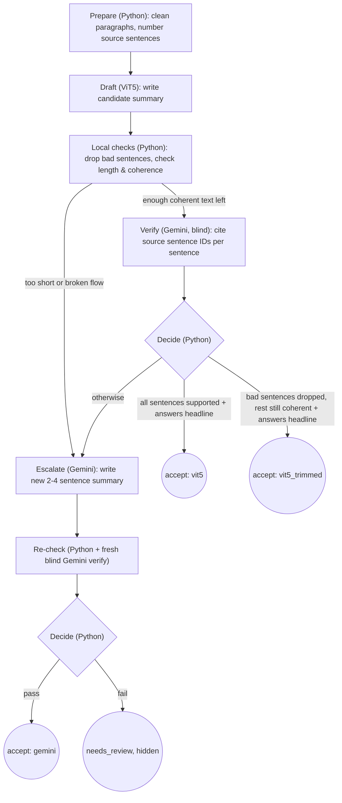

# Vision

← Back to [architecture](architecture.md) · Status: **draft for review** (2026-11-26)

Where this project is heading after the MVP, and why. Concrete tasks live in [todos.md](todos.md); this file explains the direction.

## One story, five skill areas

The project should read as one loop, not a list of features:

**raw news → clean, deduplicated data → trustworthy AI summaries → a product people use → their feedback improves the AI.**

| Area | Skill shown | What proves it |
| --- | --- | --- |
| Ingestion | Data engineering | Quality gate with reason codes, near-duplicate detection with pgvector, tags, retention, reprocessing when the model changes |
| Monitoring | Data analysis | Pipeline metrics, duplicate and rejection analysis, dashboards, an analysis report |
| Evaluation | Data science | Synthetic error set, one-time human-to-judge calibration, judge stability, thresholds tuned from measured precision/recall |
| Summarization | Agentic AI | Summarize–verify loop (ViT5 → Gemini) with a code-checked blind judge, bounded and replayable |
| Website and users | Software engineering | Supabase Auth, secure API, fast pages, light worker, personalized feed with feedback |

Guiding rules:

- **Automated ongoing judging, calibrated once.** Ongoing quality gates, duplicate checks and summary evaluation run without humans via code, local models and Gemini; a one-time ~50-article human audit measures human-to-judge agreement (Cohen's κ) so the automated judge is earned, not assumed.
- **Depth over breadth.** Fewer features, each with numbers.
- **Measure before adding complexity.** Every new step or optimization gets a before/after number.
- **Supabase PostgreSQL is the only data store.** No warehouse, lake, Kafka, Airflow, dbt, microservices or Kubernetes.
- **Summaries are for skim-reading.** Every article links prominently to the original.

## 1. Data engineering and analysis

### Quality gate (R2)

Preserve paragraph structure (`
`) and strip DOM noise (`<figcaption>`, related-article boxes, share/comment blocks) during HTML extraction instead of flattening everything into one space-joined string. Replace the ≥200-character check with combined signals (word count, sentences, overlap with the RSS title/description, duplicate lines, boilerplate phrases, `/video/` and `/photo/` URLs) and store a reason code for every rejection. Never summarize an RSS excerpt.

Thresholds are tuned with minimal labeling: Gemini judges a sample ("is this the full article for this title?"), validated against the small human calibration set, and the gate's precision/recall is measured against that. Articles that pass the gate but later fail summarization are tracked per source; a spike means a selector broke.

### Near-duplicates and story clusters

VnExpress and Tuổi Trẻ often cover the same event.

- Embed `title + first paragraph` once per article via the Gemini Embedding API (stored as `halfvec` in `pgvector`, 256–512 dims, adding zero RAM to the worker).
- Search nearest neighbours from other sources within 48 h; above a threshold → same story, grouped in `story_clusters`.
- Log the top-K candidates per article (e.g. `K = 5` or similarity ≥ 0.45) plus a 1% stratified sample of lower-score pairs in `article_similarity` (pair, score, decision) so the table stays compact while covering scores above, near and far from the threshold.
- **Periodic verification job** (analytics only, never blocks articles): sample logged pairs across score bands; decide with deterministic signals first (shared names, numbers, dates, places), Gemini only for unclear pairs. Store the verdict on the pair and report estimated precision/recall of the threshold over time.

### Categories and tags

Today: one of 6 categories and 3–5 free-text keywords per summary, recomputed per draft and lost if the summary fails. Keywords aren't shared across articles, so they can't drive filters or interests.

Publishers already provide tags on the article page the extractor downloads: Tuổi Trẻ has `article:section` and `news_keywords`/`article:tag`; VnExpress has `its_subsection`, `news_keywords`/`its_tag`, `its_type` (text/photo/video) and `its_wordcount`. Extract these `<meta>` fields in the same single HTML parse pass as article body extraction (never re-fetching the page).

Plan:

1. Gemini stays the tagger, returning 1–3 categories (from our `categories` list, marking one `is_primary`) plus typed tags (person, organization, place, topic), once per article, outside the summary loop.
2. Code drops person/organization/place tags that don't appear in the source after Unicode NFC normalization, casefolding and `tag_aliases` expansion (e.g. `TP.HCM` ↔ `Thành phố Hồ Chí Minh`).
3. Shared tables: `categories` (~10–12 publisher-aligned categories instead of a fixed 6-value enum: Thời sự, Thế giới, Kinh doanh, Công nghệ, Sức khỏe, Giáo dục, Pháp luật, Thể thao, Giải trí…), `article_categories` (many-to-many with `is_primary` and `origin` so a cross-cutting story like a bank cyber-fraud trial can live under Kinh doanh, Công nghệ and Pháp luật at once), plus `tags` (name, accent-free slug, type), `article_tags` (origin `gemini` or `publisher`) and `tag_aliases`.
4. Store publisher section and keywords raw. Map the publisher section to the primary category when present, while allowing Gemini to attach secondary categories when warranted (or pick the primary when the publisher section is missing). Agreement between Gemini and the publisher on the primary category measures classification quality without humans. `its_type` and `its_wordcount` also feed the quality gate.
5. Use multi-categories and tags in the product: category and tag filters, clickable chips, trending tags, user interests.

### Reprocessing

When the model, prompt or thresholds change, re-run summarization idempotently on articles within the ~30-day full-text retention window (plus a small frozen evaluation fixture set whose text is never purged). `summary_attempts` stores every immutable run (`1:N` per article with model version, prompt version and config hash), while `summaries` upserts the active winning summary (`winning_attempt_id` FK) so feed reads stay fast.

### Monitoring and analysis

- Per run and per source: fetched, new, duplicate URL, extracted, rejected by reason, near-duplicate, summarized, escalated, failed.
- SQL views: duplicates per day and per source pair, similarity score distribution, rejection reasons over time, time from publish to ready summary, summary outcomes per source.
- Grafana Cloud reads Postgres through a read-only role for dashboards; Sentry for errors; a notebook or Markdown report in [logs/](logs/) for deeper analysis.
- Retention: full article text kept ~30 days, then cleared (title, summary, tags and link stay); raw logs rolled up into daily tables; database size on the dashboard.

## 2. Agentic summarization

### Evaluation first (R3)

Fully reproducible—one command generates the evaluation report:

- **ROUGE** for ViT5 on a held-out slice of vietnews.
- **Synthetic error set:** take known-good summaries (vietnews references, accepted summaries) and inject errors by code: change a number, swap a name, shift a date, negate a clause, insert a sentence from another article. Every sentence has a known label, so the loop's catch rate and false-accept rate can be measured.
- **Judge calibration (one-time):** ~50 real articles labeled once by hand to measure human-to-judge agreement (Cohen's κ) and real-world false-reject rates on valid ViT5 paraphrases.
- **Stability:** run the verify step twice on the same items and report how often decisions agree.
- **Cost:** latency per article, peak RAM, logical Gemini calls and wire requests per article.

### Help ViT5 first

Most failures come from ViT5-base's limits: a 1,024-token input, a small model that can mix up names and numbers, and no way to take feedback. So:

- **Clean at paragraph/DOM level (`Prepare`):** strip `<figcaption>`, related-news boxes, bylines and `"Xem thêm"` lines while preserving paragraph breaks (`\n\n`). Segment sentences within paragraphs first using a Vietnamese abbreviation-aware splitter (`TP.`, `TS.`, `ThS.`, `PGS.`, `GS.`, `UBND.`, `HĐND.`, initials and `1.500`-style thousand separators never split sentences), then number source sentences `[1]..[N]`.
- **Long articles (>1,024 tokens):** keep contiguous **lead paragraphs + the final concluding paragraph** up to 1,023 tokens rather than cherry-picking non-contiguous sentences (which breaks ViT5's inverted-pyramid news prior); ship only if it beats plain head truncation on ROUGE and faithfulness.
- Tune decoding on the evaluation set, not by guess.
- Keep ViT5 as the default (free, offline, ours to optimize and later fine-tune); report the escalation rate to show it handles most articles.

### Summarize–verify loop

A fixed workflow, not an open-ended agent. **No AI model ever decides whether to keep, trim, escalate or publish—pure Python code decides.** ViT5 only generates candidate text, Gemini (`Verify`) only outputs structured per-sentence evidence, and Python (`Decide`) runs deterministic `if/else` rules over that evidence so every run ends in a few known steps and can be replayed offline.

1. **Local checks (Python, per sentence).** Use explicit deterministic token classes rather than open-ended regex NER: flag a summary sentence when a **digit/percentage/date** (canonicalized: `1.500` → `1500`, `25-11` / `ngày 25 tháng 11` → `25/11`) or a **multi-syllable Title-Case span** (≥ 2 consecutive capitalized words not at sentence start, after Unicode NFC + `tag_aliases` expansion such as `TP.HCM` ↔ `Thành phố Hồ Chí Minh`) is absent from the source, when it repeats an earlier sentence, or when it is a cut-off trailing sentence. Leave single-word and semantic entity checks to Gemini. Flagged sentences are dropped.
2. **Keep and coherence rules — "coherent trim" (Python, config).** Often ViT5 writes 2 good sentences plus 1 hallucinated trailing detail; instead of throwing away the whole draft and paying Gemini to rewrite, Python deletes the bad sentence if the remaining text still reads naturally. A candidate (full or trimmed) passes only if: (a) sentence 1 survives so lead context is intact, (b) **total surviving summary length** has at least `min_words` (~25 words, tuned), and (c) **no dangling reference**—if sentence `i` was dropped, no surviving sentence `k > i` may begin with an anaphoric or contrastive connector (`Tuy nhiên`, `Do đó`, `Theo đó`, `Ngoài ra`, `Ông `, `Bà `, `Người này`, `Cơ quan này`, `Điều này`) that would now point to the wrong subject. If local drops violate any of (a)–(c), Python escalates directly without spending a verify call.
3. **Verify (one blind Gemini call, temperature 0, JSON schema).** Gemini is never asked whether to publish; it only returns structured evidence—per-sentence `supported` or `not_supported` plus `cited_ids` (source sentence numbers), and summary-level `answers_headline: bool` (whether the `supported` sentences still reflect the main event in `title` without inverting its outcome). The call is **blind**: the payload `(title, numbered_source_sentences, candidate_sentences)` never reveals whether ViT5 or Gemini wrote the draft. Python then checks the judge: every canonicalized number, date and multi-syllable Title-Case span in a `supported` sentence must appear in `cited_ids ± 1 neighbor sentence ∪ {title}` (covering cross-sentence pronoun/date antecedents); otherwise Python downgrades that sentence to `not_supported`. Citing IDs instead of quoting text avoids false failures from spacing or diacritics.
4. **Decide (pure Python function).** Require `answers_headline == True`. If all sentences are `supported` → accept with origin `vit5`. If bad sentences were dropped (`not_supported`) and the remaining sentences still pass the **coherent trim** rules above → accept with origin `vit5_trimmed` (shown as `ViT5` in the UI, but tracked separately in the DB so analytics can measure how many Gemini escalations trimming saved). Otherwise → escalate.
5. **Escalate + fresh blind re-check (`G → C2 → X2`).** Gemini writes a new 2–4 sentence summary with a dedicated summarization prompt, and we **do not blindly trust Gemini's output**—it goes through the exact same gauntlet (`C2`): Python's deterministic **local checks** and coherence rules, followed by a **fresh** (brand-new stateless API call, not a multi-turn chat continuation where the LLM would defend what it just wrote) and **blind** (same model-agnostic JSON input, minimizing self-preference bias) `Verify` call. Pass → accept (`gemini`). Fail → `needs_review`, hidden. No further attempts.

Limits: 1 ViT5 draft and 1 logical Gemini call inside the summary loop on the happy path, or 3 on escalation—plus 1 tagging call outside the loop (2 logical Gemini calls typical, 4 max; with up to 3 HTTP wire attempts per call on 429/5xx, 6–12 wire requests worst-case versus 2–4 logical calls / 12 wire requests today where retries also recompute metadata).

Infrastructure errors are not quality failures: on Gemini timeout, rate limit or bad JSON (after HTTP retry) the article stays `pending` with backoff and becomes `failed` after 3 cycles; a circuit breaker skips Gemini when most recent calls fail. Nothing unverified is ever published.

Every step writes an immutable `summary_attempts` row (model and prompt version, config hash, sentences, local flags, verdicts, citations, `answers_headline`, decision, latency). A `replay` command re-runs `Decide` and local/citation rules with new thresholds on stored attempts without calling any model.

Record in [decisions.md](decisions.md) that Gemini may now write fallback summaries; store which model wrote each summary (`vit5`, `vit5_trimmed`, `gemini`) and show a subtle model chip (`Tóm tắt AI · ViT5` / `Tóm tắt AI · Gemini`) in the article detail view for transparency.

Not in the first version (only if evaluation shows a measured gap): multiple ViT5 candidates, LLM sentence-editing, a local NLI judge (skipped for now—~600 MB extra RAM and weaker than citation-checked Gemini Flash on multi-sentence Vietnamese news).

### Feedback loop for ViT5 (later)

Store every candidate summary and its verdicts in `summary_attempts`, not only the winner. A rejected ViT5 draft and the accepted Gemini summary that replaced it form a natural preference pair. Fine-tune ViT5 on a free GPU (distillation from accepted Gemini summaries, then preference training) only once ≥ 1,000 real pairs are logged and ViT5's post-cleaning escalation rate remains > 20%; ship only if evaluation improves. User 👍/👎 is used for evaluation and alerts, not as training labels.

### Related news

At the end of each article: **"Cùng sự kiện"** (same story from other sources, from `story_clusters`) and **"Tin liên quan"** (nearest articles by embedding, excluding the same story). No extra model.

## 3. Website: security and performance

- **Auth:** Supabase Auth (email, optionally Google); FastAPI verifies the Supabase JWT and filters every user query by `user_id`. Row Level Security on user tables as a second layer.
- **Light worker:** export ViT5 to ONNX with int8 weights; publish a table of RAM, latency, image size and summary quality before and after. Ship int8 only if quality holds.
- **Fast pages:** keyset pagination, HTTP caching on the feed, indexes checked with `EXPLAIN ANALYZE`, lazy images with fixed sizes, skeleton loading, route code-splitting.
- **Targets:** API p95 under 200 ms (load-tested), Lighthouse mobile ≥ 90, time from publish to summary tracked as p50/p95.
- **Basics:** rate limiting, strict CORS, security headers, input limits.

## 4. Product: users and feedback

- Invite-only sign-up/sign-in, interests (categories and tags) at onboarding, chosen sources, and a clear model label (`ViT5` / `Gemini`) on summaries.
- 👍/👎 per article with an optional reason ("tóm tắt sai", "không quan tâm").
- Personalized feed: SQL score from interest match, recency and own feedback.
- 👎 "tóm tắt sai" adds the article to the evaluation set.

## 5. Deployment

ViT5 needs more RAM than most free tiers give, so the worker decides the host. Plan: measure RAM after ONNX/int8, then prefer one free VM (e.g. Oracle Always Free Arm) running the whole Compose stack; fallback is a static frontend + free API host + worker on my own machine. Supabase stays the database.

Publishers allow personal, non-commercial use: gate hosted access behind an invite allowlist in Supabase Auth (no open public sign-up or unauthenticated bulk feed redistribution), show title + short summary + prominent original link, and recheck publisher terms before inviting anyone.

## 6. Diagrams

Draw the key diagrams with [diagram-design](https://github.com/cathrynlavery/diagram-design) for the README: system overview, data pipeline funnel, summarize–verify loop, deployment map. Small diagrams inside specs stay in Mermaid.

## Phases

| Phase | Focus | Minimum done |
| --- | --- | --- |
| 1. Trust | R1 review gate, R2 quality gate, R3 evaluation + ~50-article calibration, R5 CI | Rejected summaries hidden; evaluation report reproducible |
| 2. Agent loop | Paragraph/sentence prep, summarize–verify loop, `summary_attempts`, replay, synthetic error set | False-accept, false-reject and escalation rates measured |
| 3. Data | Single-pass publisher meta, tags/categories, Gemini embeddings, story clusters, verification job, dashboards, reprocessing | Duplicates detected and charted |
| 4. Efficient | ONNX + int8 ViT5, retention, page and API performance | Before/after table for RAM, latency and page speed |
| 5. Product | Reader (R4), invite-only auth, interests, feedback, personalized feed, related news, deployment | A few invited users sign in and give feedback |
| Ongoing | Key diagrams, portfolio README (R6), demo video | — |

Target numbers for the README: ROUGE on vietnews; human-to-judge κ, false-accept and escalation rates; duplicate precision/recall estimate; worker RAM and latency before/after int8; API p95 and Lighthouse score; logical Gemini calls per article.

## Out of scope

Data warehouse or lake, streaming, orchestration frameworks, microservices, Kubernetes, custom auth, a vector database other than pgvector, GPU inference without a measured need.

## Open questions

- Embedding dimension in `pgvector` (`halfvec`): 256 vs 512 dims on Vietnamese story clustering precision/recall?
- Database for people running the public code: Supabase, a local PostgreSQL container, or SQLite?
- Should `vit5_trimmed` require at least 2 surviving sentences, or is 1 detailed lead sentence (≥ 25 words) enough when `answers_headline` passes?
